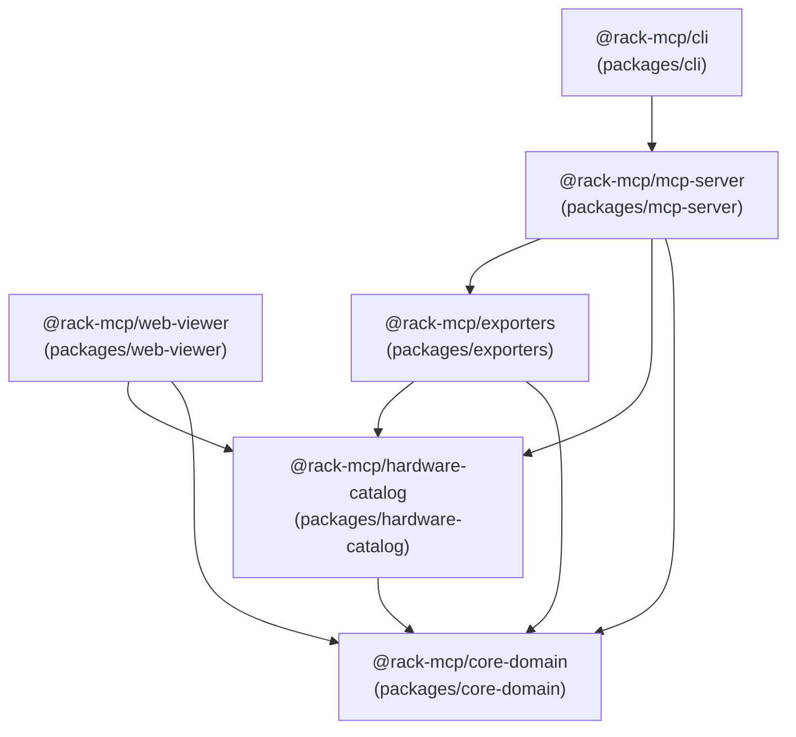
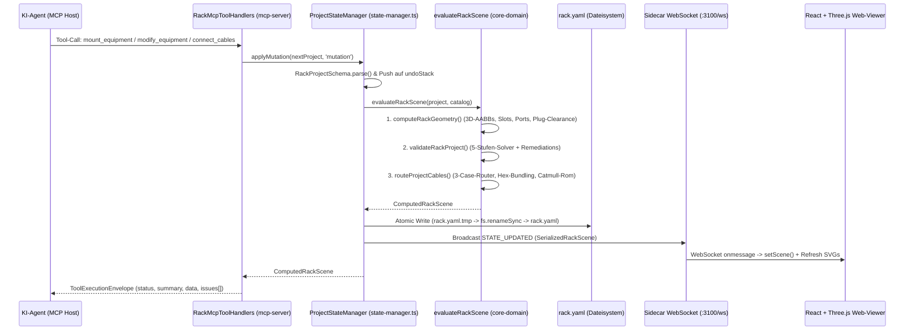

# Gesamtdokumentation & Technisches Referenzhandbuch — RackArchitect MCP (`@rack-mcp/*`)

> **Zweck dieses Dokuments:**  
> Diese Datei ist die **vollständige, lückenlose Single-Source-of-Truth-Systemdokumentation** des Projekts **RackArchitect MCP**. Sie ist so verfasst, dass sowohl **Menschen** (Entwickler, Netzwerk-/Homelab-Architekten, Prüfer) als auch **KI-Agenten / LLMs** (bei einer Codebase-Analyse oder Tool-Nutzung) jedes Detail des Systems verstehen, nachvollziehen und bis auf die einzelne Codezeile, mathematische Formel und UI-Schaltfläche zurückverfolgen (`tracen`) können.

---

## Inhaltsverzeichnis

1. [Was ist RackArchitect MCP und wofür ist es da?](#1-was-ist-rackarchitect-mcp-und-wofür-ist-es-da)
2. [Sicherheit, Netzwerk, Ports & „Admin-Passwort“ (Zero-Auth-Architektur)](#2-sicherheit-netzwerk-ports--admin-passwort-zero-auth-architektur)
3. [Monorepo-Architektur, Paketgrenzen & Verzeichnisstruktur](#3-monorepo-architektur-paketgrenzen--verzeichnisstruktur)
4. [Physikalisches 3D-Koordinatensystem & Mechanische Normen (`@rack-mcp/core-domain`)](#4-physikalisches-3d-koordinatensystem--mechanische-normen-rack-mcpcore-domain)
5. [Datenmodelle & Strikte Zod-Schemas (`rack.yaml` & Blueprints)](#5-datenmodelle--strikte-zod-schemas-rackyaml--blueprints)
6. [Die 5-stufige Deterministische Validierungs-Engine (`validateRackProject`)](#6-die-5-stufige-deterministische-validierungs-engine-validaterackproject)
7. [Die 3D-Kabel-Routing- & Längenberechnungs-Engine (`catmull-rom-router.ts`)](#7-die-3d-kabel-routing---längenberechnungs-engine-catmull-rom-routerts)
8. [Der Hardware-Katalog (`@rack-mcp/hardware-catalog`) — Alle 20 Blueprints](#8-der-hardware-katalog-rack-mcphardware-catalog--alle-20-blueprints)
9. [Der MCP-Server, State-Manager & Sidecar-Server (`@rack-mcp/mcp-server`)](#9-der-mcp-server-state-manager--sidecar-server-rack-mcpmcp-server)
10. [Das Dashboard & 3D/2D Web-Viewer UI — Jede Schaltfläche im Detail (`@rack-mcp/web-viewer`)](#10-das-dashboard--3d2d-web-viewer-ui--jede-schaltfläche-im-detail-rack-mcpweb-viewer)
11. [Die 4 CAD- & Dokumentations-Exporter (`@rack-mcp/exporters`)](#11-die-4-cad---dokumentations-exporter-rack-mcpexporters)
12. [Das Kommandozeilen-Werkzeug (`@rack-mcp/cli` / `rack-mcp`)](#12-das-kommandozeilen-werkzeug-rack-mcpcli--rack-mcp)
13. [End-to-End Datenfluss & Tracing-Szenarien (Mensch & KI-Agent)](#13-end-to-end-datenfluss--tracing-szenarien-mensch--ki-agent)
14. [Das Referenzprojekt `examples/10inch-homelab` (Vollständiges Walkthrough)](#14-das-referenzprojekt-examples10inch-homelab-vollständiges-walkthrough)

---

## 1. Was ist RackArchitect MCP und wofür ist es da?

### 1.1 Das Problem
Wer einen Netzwerkschrank oder ein Homelab-Rack plant – insbesondere kompakte **10-Zoll Mini-Racks** (wie DeskPi RackMate T1/T2, Digitus SOHO) oder dicht gepackte **19-Zoll Enterprise-Racks** und **6-Zoll Micro-Racks** –, steht vor komplexen physikalischen Abhängigkeiten:
- Passt ein `185 mm` tiefes Gerät auf `U1` vorne noch in ein `240 mm` tiefes Rack, wenn auf `U1` hinten eine Steckdosenleiste (`55 mm` Tiefe) sitzt und hinten am Gerät noch ein kaltgerätestecker (`IEC-C13`, `+55 mm` Biegeradius) herausragt?
- Wie lang müssen die Patch- und Stromkabel exakt sein (`0.15 m`, `0.25 m`, `0.50 m`, `1.00 m`), wenn sie sauber durch die seitlichen Kabelschächte und Bürstenleisten (`brush-panel`) geführt werden?
- Reicht das PoE-Budget des Switches (`196 W` Gesamtbudget, `15.4 W / 30 W / 60 W / 90 W` pro Port-Klasse) und die Kapazität der USV (`300 W` / `1000 W`) für alle angeschlossenen Verbraucher?
- Passt ein Mini-PC (z. B. Lenovo ThinkCentre M920q Tiny) samt Keystone-Modulen maßhaltig in einen 3D-gedruckten 1HE-Carrier?

Wenn man ein Sprachmodell (LLM) ohne deterministische Physik-Engine bittet, ein solches Rack zu planen, halluziniert das LLM Maße, übersieht Stecker-Tiefenkollisionen und rät Kabellängen falsch.

### 1.2 Die Lösung: Agent-First „Rack-as-Code“
**RackArchitect MCP** löst dieses Problem durch eine **deterministische Hybrid-Sidecar-Architektur**, die auf **drei unumstößlichen Grundgesetzen (Three Golden Laws)** basiert (definiert in [`AGENTS.md`](file:///home/alexb/projects/rack-designer/AGENTS.md) und [`ARCHITECTURE.md`](file:///home/alexb/projects/rack-designer/ARCHITECTURE.md)):

1. **Gesetz 1 — LLMs raten niemals Geometrie:**  
   KI-Agenten berechnen niemals Koordinaten, Kabellängen oder Tiefenkollisionen im eigenen Kontextfenster. Jede räumliche, elektrische und mechanische Wahrheit wird deterministisch in Millimetern (`mm`, wobei $1\text{ U} = 44.45\text{ mm}$) durch das Kernpaket [`@rack-mcp/core-domain`](file:///home/alexb/projects/rack-designer/packages/core-domain/src/index.ts) berechnet.
2. **Gesetz 2 — Single Source of Truth (`rack.yaml`):**  
   Der gesamte deklarative Zustand eines geplanten Racks liegt in einer einzigen, menschenlesbaren, Git-freundlichen YAML-Datei (`rack.yaml`), die zur Laufzeit durch strikte Zod-Schemas validiert wird. Abgeleitete 3D-Koordinaten werden niemals redundant in der `rack.yaml` gespeichert, sondern immer frisch aus der `rack.yaml` + dem Hardware-Katalog berechnet.
3. **Gesetz 3 — Actionable Self-Correction Feedback:**  
   Immer wenn eine Aktion oder Validierung einen Fehler oder eine Warnung auslöst (z. B. `PLUG_CLEARANCE_COLLISION`, `POE_BUDGET_EXCEEDED`, `UNPOWERED_DEVICE`), wirft der MCP-Server **keine** unstrukturierte Exception, sondern gibt ein strukturiertes Diagnose-Objekt (`DiagnosticIssue`) inklusive konkreter Handlungsanweisungen (`remediation_suggestions` und `remediation_actions`) zurück. Dadurch kann sich ein KI-Agent im nächsten Schritt selbst korrigieren (z. B. die rückseitige PDU auf eine freie HE verschieben oder ein gewinkeltes Stromkabel wählen).

---

## 2. Sicherheit, Netzwerk, Ports & „Admin-Passwort“ (Zero-Auth-Architektur)

Wenn jemand dieses Projekt untersucht und sich fragt: *„Wie logge ich mich ein? Wie lautet das Admin-Passwort? Welche Zugangsdaten, Tokens oder Datenbanken gibt es?“*, lautet die exakte technische Antwort:

### 2.1 Kein Admin-Passwort / Keine Authentifizierung (Zero-Auth Local-First Design)
- **Es gibt kein Admin-Passwort, keinen Benutzer-Login, keine Session-Cookies und keine Datenbank.**
- Das gesamte System arbeitet als **lokales CAD- & Engineering-Werkzeug** direkt auf der lokalen Projektdatei (`rack.yaml`).
- Jeder, der das Web-Dashboard öffnet, hat sofort vollen Lese- und Schreibzugriff auf die aktuell geladene Szene.

### 2.2 Netzwerk-Ports & Bind-Adressen
| Komponente | Standard-Host | Standard-Port | Protokoll | Quelldatei |
| :--- | :--- | :--- | :--- | :--- |
| **MCP-Server (KI-Host-Kommunikation)** | Prozess-Standard-I/O | — (`stdin` / `stdout`) | JSON-RPC 2.0 (MCP `stdio`) | [`packages/mcp-server/src/mcp/server.ts`](file:///home/alexb/projects/rack-designer/packages/mcp-server/src/mcp/server.ts#L393-L397) |
| **Sidecar HTTP-Server (REST API + Web-UI Hosting)** | `127.0.0.1` (Loopback) | `3100` (konfigurierbar per `--port`) | HTTP (`GET`, `OPTIONS`) | [`packages/mcp-server/src/sidecar/sidecar-server.ts`](file:///home/alexb/projects/rack-designer/packages/mcp-server/src/sidecar/sidecar-server.ts#L69-L70) |
| **Sidecar WebSocket-Server (Echtzeit-Sync)** | `127.0.0.1` (Loopback) | `3100` (Pfad `/ws`) | WebSocket (`ws://127.0.0.1:3100/ws`) | [`packages/mcp-server/src/sidecar/sidecar-server.ts`](file:///home/alexb/projects/rack-designer/packages/mcp-server/src/sidecar/sidecar-server.ts#L187) |
| **Vite Dev-Server (nur für Frontend-Entwicklung)** | `localhost` | `5173` | HTTP + HMR | [`packages/web-viewer/vite.config.ts`](file:///home/alexb/projects/rack-designer/packages/web-viewer/vite.config.ts) |

### 2.3 Eingebaute Sicherheits- und Schutzmechanismen
1. **Loopback-Only Binding (`127.0.0.1`):**  
   Der Sidecar-Server lauscht standardmäßig ausschließlich auf `127.0.0.1` (nicht `0.0.0.0`), sodass kein Zugriff aus dem lokalen Netzwerk (LAN) möglich ist.
2. **Directory-Traversal-Schutz beim Static File Serving:**  
   In [`sidecar-server.ts` (Zeilen 152–161)](file:///home/alexb/projects/rack-designer/packages/mcp-server/src/sidecar/sidecar-server.ts#L152-L161) wird jede statische Dateianfrage über `path.resolve(distRoot, requestedRel)` aufgelöst und zwingend mit `candidatePath.startsWith(distRoot)` geprüft. Anfragen wie `/../../etc/passwd` werden dadurch deterministisch blockiert und mit HTTP `404` beantwortet.
3. **Atomare Datei-Persistenz & Write-Lock gegen Race-Conditions:**  
   In [`state-manager.ts` (Zeilen 303–322)](file:///home/alexb/projects/rack-designer/packages/mcp-server/src/state-manager.ts#L303-L322) wird `rack.yaml` niemals direkt überschrieben, sondern zuerst komplett nach `rack.yaml.tmp` geschrieben und dann per Betriebssystem-Syscall `fs.renameSync(tmpPath, this.projectPath)` atomar ersetzt. Währenddessen verhindert `isWritingLock = true` (mit `60 ms` Nachlaufzeit), dass der eigene Dateisystem-Watcher (`fs.watch`) die eigene Speicherung fälschlicherweise als externe Änderung interpretiert.
4. **Strikte `stdio`-Trennung für MCP:**  
   Im `serve`-Modus der CLI ([`packages/cli/src/index.ts` (Zeile 166)](file:///home/alexb/projects/rack-designer/packages/cli/src/index.ts#L166)) werden alle Status-Logs ausschließlich auf `process.stderr` ausgegeben, damit `process.stdout` zu 100 % sauber für den JSON-RPC-Stream des Model Context Protocols bleibt.

---

## 3. Monorepo-Architektur, Paketgrenzen & Verzeichnisstruktur

Das Repository ist ein strikt geschichtetes **TypeScript 5.x / pnpm-Workspace Monorepo**. Zirkuläre Abhängigkeiten sind verboten.



### 3.1 Paket-Matrix & Verantwortlichkeiten

| Paket | Pfad | Erlaubte interne Abhängigkeiten | Hauptaufgabe |
| :--- | :--- | :--- | :--- |
| **`@rack-mcp/core-domain`** | [`packages/core-domain`](file:///home/alexb/projects/rack-designer/packages/core-domain/src/index.ts) | **KEINE** (`"types": []` in `tsconfig.json`) | Reine Mathematik, Konstanten, Zod-Schemas, Port-Matrix-Expander, 3D-Koordinaten-Transformer, 5-Stufen-Validierungs-Engine, 3D-Catmull-Rom-Kabelrouter. Läuft identisch in Node.js und im Browser. |
| **`@rack-mcp/hardware-catalog`** | [`packages/hardware-catalog`](file:///home/alexb/projects/rack-designer/packages/hardware-catalog/src/index.ts) | `@rack-mcp/core-domain` | 20 kuratierte YAML-Hardware-Blueprints (`catalog/10inch`, `catalog/19inch`, `catalog/carriers`, `catalog/sub-modules`), eingebettetes TS-Bundle (`embedded-catalog.ts`), Geometrie-Integritäts-Validator und Such-/Filter-Registry (`CatalogRegistry`). |
| **`@rack-mcp/exporters`** | [`packages/exporters`](file:///home/alexb/projects/rack-designer/packages/exporters/src/index.ts) | `@rack-mcp/core-domain`, `@rack-mcp/hardware-catalog` | Deterministische Generatoren für `elevation.svg` (2D-Ansichten + Z-Y-Tiefenschnitt), `wiring-schematic.svg` (Strom-DAG + orthogonales Pin-zu-Pin-Schaltbild), `BOM.md` (Stückliste + 3D-Druck-Queue + Patch-Checkliste) und `rack-scene.glb` (binäres 3D glTF 2.0 Modell). |
| **`@rack-mcp/mcp-server`** | [`packages/mcp-server`](file:///home/alexb/projects/rack-designer/packages/mcp-server/src/index.ts) | `@rack-mcp/core-domain`, `@rack-mcp/hardware-catalog`, `@rack-mcp/exporters` | `ProjectStateManager` (Undo/Redo, File-Watcher, Atomic-Save), `RackMcpToolHandlers` (11 Tools), `createRackMcpServer` (MCP über `stdio`, 4 Resources, 2 Prompts), `generateAsciiElevation` und `startRackSidecarServer` (`HTTP + WebSocket`). |
| **`@rack-mcp/web-viewer`** | [`packages/web-viewer`](file:///home/alexb/projects/rack-designer/packages/web-viewer/src/index.ts) | `@rack-mcp/core-domain`, `@rack-mcp/hardware-catalog` | Interaktives React 19 + Three.js (`@react-three/fiber`) CAD-Dashboard mit Dual-Mode (`sidecar-live` per WebSocket oder `standalone-demo` direkt im Browser) und Client-Side WebMCP (`document.modelContext`). |
| **`@rack-mcp/cli`** | [`packages/cli`](file:///home/alexb/projects/rack-designer/packages/cli/src/index.ts) | `@rack-mcp/mcp-server` (und transitiv alle Pakete) | Kommandozeilen-Einstiegspunkt (`rack-mcp`) mit den Befehlen `serve`, `validate` und `export`. |

### 3.2 Vollständiger Dateibaum des Projekts

```text
rack-designer/
├── AGENTS.md                                      # Verbindliche Architektur- & Coding-Regeln für KI-Agenten
├── ARCHITECTURE.md                                # Mathematische & technische Systemspezifikation
├── PROJECT_DOCUMENTATION.md                       # Dieses vollständige Referenzhandbuch
├── README.md                                      # Schnellstart-Übersicht
├── package.json                                   # Root-Skripte (build, test, typecheck, validate:catalog, dev)
├── pnpm-workspace.yaml                            # Workspace-Definition (packages/*)
├── tsconfig.base.json                             # Strikte Compiler-Gates (strict, noUncheckedIndexedAccess, etc.)
├── vitest.config.ts                               # Test-Runner-Konfiguration
├── examples/
│   └── 10inch-homelab/                            # Vollständiges 8U 10-Zoll Referenzprojekt
│       ├── rack.yaml                              # Deklarative Quelle (8 Top-Level-Geräte, 10 Sub-Module, 18 Kabel)
│       ├── elevation.svg                          # Generierte 2D-CAD-Ansicht (Front, Rear, Side-Cutaway)
│       ├── wiring-schematic.svg                   # Generierter 2D-Strom- & Netzwerk-Schaltplan
│       ├── BOM.md                                 # Generierte Stückliste & Aufbauanleitung
│       └── rack-scene.glb                         # Generiertes binäres 3D-Modell (glTF 2.0)
└── packages/
    ├── core-domain/
    │   └── src/
    │       ├── index.ts                           # evaluateRackScene(), serializeRackScene()
    │       ├── schemas/
    │       │   ├── constants.ts                   # MM_PER_U, EIA_310_SPECS, DELTA_Z_PLUG_MM, POE_CLASS_WATTS
    │       │   ├── hardware-blueprint.ts          # HardwareBlueprintSchema, PortDefinitionSchema, SlotDefinitionSchema
    │       │   ├── port-expander.ts               # expandPortGroupMacro(), normalizeHardwareBlueprint()
    │       │   ├── rack-project.ts                # RackProjectSchema, MountedDeviceSchema, CableConnectionSchema
    │       │   ├── validation-result.ts           # ValidationResultSchema, DiagnosticIssueSchema, DiagnosticCodeSchema
    │       │   └── mcp-tools.ts                   # MCP_TOOL_DEFINITIONS (alle 11 Tools + Input-Schemas)
    │       ├── geometry/
    │       │   ├── precision.ts                   # roundMm(), roundCentis(), roundTenths(), AABB_INTERSECTION_EPSILON_MM
    │       │   ├── types.ts                       # Vector3D, BoundingBox3D, ComputedRackGeometry, ComputedDeviceGeometry
    │       │   ├── aabb.ts                        # vec3-Mathematik, boxesIntersect(), getBoxIntersection()
    │       │   └── coordinate-transformer.ts      # computeRackGeometry(), transformLocalToWorldPoint(), Coupler-Auflösung
    │       ├── validation/
    │       │   └── validation-engine.ts           # validateRackProject() (5-Stufen-Solver + Remediation-Synthesizer)
    │       └── routing/
    │           └── catmull-rom-router.ts          # routeProjectCables(), 3-Case-Router, Hex-Bundling, Catmull-Rom-Spline
    ├── hardware-catalog/
    │   ├── catalog/                               # 20 YAML-Hardware-Blueprints auf Disk
    │   └── src/
    │       ├── embedded-catalog.ts                # Eingebettete YAML-Strings für Browser-Kompatibilität ohne fs
    │       ├── catalog-validator.ts               # validateBlueprintIntegrity(), Port-/Slot-Overlap-Prüfung
    │       ├── catalog-registry.ts                # CatalogRegistry (Suche, Filter, Custom-Blueprints)
    │       └── validate-cli.ts                    # CLI-Prüfskript für `pnpm validate:catalog`
    ├── exporters/
    │   └── src/
    │       ├── elevation-svg.ts                   # generateElevationSvg()
    │       ├── wiring-svg.ts                      # generateWiringSchematicSvg()
    │       ├── bom-markdown.ts                    # generateBomMarkdown()
    │       ├── glb-exporter.ts                    # generateGlbBinary()
    │       └── reference-homelab.ts               # create10InchHomelabProjectInput(), evaluate10InchHomelabScene()
    ├── mcp-server/
    │   └── src/
    │       ├── state-manager.ts                   # ProjectStateManager (Undo/Redo, Atomic Save, File-Watcher)
    │       ├── ascii-elevation.ts                 # generateAsciiElevation() für LLM-Kontextfenster
    │       ├── mcp/
    │       │   ├── tool-handlers.ts               # RackMcpToolHandlers (Ausführungslogik aller 11 Tools)
    │       │   └── server.ts                      # createRackMcpServer() (Tools, 4 Resources, 2 Prompts)
    │       └── sidecar/
    │           └── sidecar-server.ts              # startRackSidecarServer() (HTTP REST + Static SPA + WebSocket /ws)
    ├── web-viewer/
    │   └── src/
    │       ├── main.tsx                           # React-DOM Einstiegspunkt (#root)
    │       ├── state/
    │       │   ├── useRackState.ts                # Zentraler State-Hook, WebSocket-Sync & Browser-WebMCP-Brücke
    │       │   └── standalone-homelab.ts          # Browser-Fallback-Evaluierung & Client-Side SVG/BOM-Renderer
    │       └── components/
    │           ├── ui/
    │           │   ├── AppDashboard.tsx           # Hauptlayout (TopNavBar + Main View + InspectorSidebar)
    │           │   ├── TopNavBar.tsx              # Obere Leiste (4 Ansichten, Status-Badges, Undo/Redo/Reset)
    │           │   ├── FloatingHudToolbar.tsx     # 3D-HUD (Kameras, Kabelfilter, X-Ray, B_clearance, Door, Explode-Z)
    │           │   ├── InspectorSidebar.tsx       # Rechte Sidebar (Telemetrie, 5-Stage-Konsole, Selection Inspector)
    │           │   ├── SvgPanZoomViewer.tsx       # Interaktiver 2D-SVG-Betrachter mit Zoom/Pan/Download
    │           │   └── BomAndExportsView.tsx      # Stücklisten-, 3D-Druck- & Download-Ansicht
    │           └── canvas/
    │               ├── RackSceneCanvas.tsx        # Three.js Canvas, ResizeObserver, Kamera-Steuerung, Port-Tooltip
    │               ├── RackFrame3D.tsx            # 3D-Rack-Rahmen, EIA-310-Schienen, Käfigmuttern, Rauchglastür
    │               ├── MountedDevice3D.tsx        # 3D-Geräte-Chassis, Rack-Ohren, Schrauben, OLED-Screens
    │               ├── PortMesh3D.tsx             # 1.8mm erhabene 3D-Port-Buchsen mit Link-/PoE-LEDs
    │               └── CableTube3D.tsx            # 3D-Spline-Kabelrohre mit Knickschutz-Tüllen (Boots)
    └── cli/
        └── src/
            ├── index.ts                           # parseCliArgs(), runCli() (serve, validate, export)
            └── bin.ts                             # Ausführbares Node-Skript (#!/usr/bin/env node)
```

---

## 4. Physikalisches 3D-Koordinatensystem & Mechanische Normen (`@rack-mcp/core-domain`)

Alle Berechnungen finden in [`packages/core-domain/src/geometry/`](file:///home/alexb/projects/rack-designer/packages/core-domain/src/geometry/coordinate-transformer.ts) statt.

### 4.1 Fließkomma-Präzision & Determinismus ([`precision.ts`](file:///home/alexb/projects/rack-designer/packages/core-domain/src/geometry/precision.ts))
Um IEEE-754-Rundungsfehler (wie `0.1 + 0.2 = 0.30000000000000004`) auszuschließen, verwendet das gesamte System ausschließlich drei kanonische Rundungsfunktionen:
- **`roundMm(value)`**: Rundet auf $10^{-4}\text{ mm}$ ($0.1\ \mu\text{m}$) für alle 3D-Raumkoordinaten.
- **`roundCentis(value)`**: Rundet auf $10^{-2}$ für Bogenlängen, Schwerpunkt und Wattzahlen.
- **`roundTenths(value)`**: Rundet auf $10^{-1}$ für Diagnose-Anzeigewerte.
- **`AABB_INTERSECTION_EPSILON_MM = 1e-3`** ($0.001\text{ mm}$): Zwei Bounding-Boxen gelten nur dann als kollidierend, wenn ihre Überlappung auf **allen drei Achsen (`X`, `Y`, `Z`) strikt größer als `0.001 mm`** ist ([`boxesIntersect` in `aabb.ts`](file:///home/alexb/projects/rack-designer/packages/core-domain/src/geometry/aabb.ts#L58-L67)). Dadurch lösen Geräte, die sich an der Grenze zwischen `U1` ($Y_{\max} = 44.45\text{ mm}$) und `U2` ($Y_{\min} = 44.45\text{ mm}$) exakt berühren, niemals einen Fehlalarm aus.

### 4.2 Das Rechtshändige 3D-Weltkoordinatensystem
- **Ursprung `(0, 0, 0)`:** Untere, vordere, linke Außenkante der nutzbaren Rack-Frontplattenebene bei `U1`.
- **X-Achse (Breite, Links $\rightarrow$ Rechts):** `X = 0` ist die linke Außenkante der Frontplatte; `X = W_panel` ist die rechte Außenkante.
- **Y-Achse (Höhe, Unten $\rightarrow$ Oben):** `Y = 0` ist die Unterkante von `U1`. Jede Höheneinheit $u \in \{1, \dots, N_U\}$ (`MM_PER_U = 44.45 mm`) erstreckt sich über:
  $$Y_{\min}(u) = (u - 1) \times 44.45\text{ mm}, \qquad Y_{\max}(u) = u \times 44.45\text{ mm}$$
- **Z-Achse (Tiefe, Vorne $\rightarrow$ Hinten):**
  - `Z = 0`: Vorderseite der vorderen vertikalen Montageschienen (Front-Rails).
  - `Z < 0`: Bereich **vor** den vorderen Schienen (Rack-Ohren, Griffe, herausstehende Front-Patchkabel, bis hin zur vorderen Glastür bei `Z = -front_door_clearance_mm`).
  - `Z > 0`: Bereich **im** Rack-Inneren bis zu den hinteren Montageschienen bei `Z = rail_depth_mm` (und dahinter bis `Z = rail_depth_mm + rear_clearance_mm`).

### 4.3 EIA-310-D & Homelab Rack-Breitenstandards ([`constants.ts`](file:///home/alexb/projects/rack-designer/packages/core-domain/src/schemas/constants.ts#L38-L84))

| Standard (`RackStandardSlug`) | Gesamtbreite Frontplatte (`W_panel`) | Lichte Schienenöffnung (`W_aperture`) | Lochabstand Mitte-zu-Mitte (`W_holes`) | Linke Schienenbreite (`X_aperture_min`) | Linke Lochmitte (`X_hole_left`) |
| :--- | :---: | :---: | :---: | :---: | :---: |
| **`19inch`** | `482.60 mm` | `450.85 mm` | `465.10 mm` | `15.875 mm` | `8.75 mm` |
| **`10inch`** | `254.00 mm` | `222.25 mm` | `236.50 mm` | `15.875 mm` | `8.75 mm` |
| **`6inch`** | `152.40 mm` | `120.65 mm` | `134.90 mm` | `15.875 mm` | `8.75 mm` |

Innerhalb jeder Höheneinheit (`44.45 mm`) sitzen auf beiden Schienen jeweils **3 Käfigmuttern-Löcher** bei den vertikalen Offsets `U_HOLE_OFFSETS_MM = [6.35, 22.225, 38.1] mm` relativ zu `Y_min(u)`.

### 4.4 Transformation für Front- vs. Rear-Montage & Sub-U-Module (`Carrier -> Slot -> Child`)
In [`coordinate-transformer.ts`](file:///home/alexb/projects/rack-designer/packages/core-domain/src/geometry/coordinate-transformer.ts#L86-L135) gilt:
1. **Geräte-Ursprung (`computeCarrierOrDeviceOrigin`):**
   - Bei `face === 'front'`: $\vec{O}_{\text{mount}} = (0,\ (u - 1) \times 44.45,\ 0)$
   - Bei `face === 'rear'`: $\vec{O}_{\text{mount}} = (W_{\text{panel}},\ (u - 1) \times 44.45,\ D_{\text{rail}})$
2. **Lokale-zu-Welt-Punkt-Transformation (`transformLocalToWorldPoint`):**
   - Bei `front`: $\vec{P}_{\text{world}} = (O_x + x_{\text{local}},\ O_y + y_{\text{local}},\ O_z + z_{\text{local}})$
   - Bei `rear` (um $180^\circ$ um die Y-Achse gedreht eingebaut): $\vec{P}_{\text{world}} = (O_x - x_{\text{local}},\ O_y + y_{\text{local}},\ O_z - z_{\text{local}})$
3. **Sub-U-Kindgeräte in einem Modular-Carrier:**
   - Besitzt ein Carrier einen Slot mit `offset_mm = (x_s, y_s, z_s)`, wird jeder Port des eingebauten Sub-Moduls berechnet durch:
     $$\vec{P}_{\text{port, local\_in\_mount}} = \vec{O}_{\text{slot}} + \vec{P}_{\text{port, local\_in\_child}}$$
     und anschließend über `transformLocalToWorldPoint` in den globalen 3D-Raum überführt.

### 4.5 Stecker-Clearance & Biegeradius-Tabelle (`DELTA_Z_PLUG_MM`)
Sobald an einem Port ein Kabel angeschlossen ist, extrudiert [`computeDevicePlugClearances`](file:///home/alexb/projects/rack-designer/packages/core-domain/src/geometry/coordinate-transformer.ts#L253-L330) entlang der Auswärts-Normalen (`world_normal.z`, also `-1` nach vorne oder `+1` nach hinten) eine **Stecker-Clearance-Bounding-Box (`B_clearance`)** um den Betrag $\Delta Z_{\text{plug}}$:

| Stecker-Typ (`ConnectorType`) | Gerader Stecker (`straight_mm`) | Gewinkelter Stecker (`angled_mm`, wenn `cable_type` `"angled"` enthält) |
| :--- | :---: | :---: |
| **`rj45`** / **`rj45-serial-console`** | `35 mm` | `20 mm` |
| **`sfp-plus`** | `48 mm` | *nicht verfügbar (`null`)* |
| **`iec-c13`** / **`iec-c14`** | `55 mm` | `30 mm` |
| **`schuko-cee7`** | `65 mm` | `38 mm` |
| **`dc-5525`** / **`usb-c`** / **`usb-a`** | `32 mm` | `18 mm` |
| **`audio-35mm`** | `28 mm` | `15 mm` |

---

## 5. Datenmodelle & Strikte Zod-Schemas (`rack.yaml` & Blueprints)

Alle Schemas sind in [`packages/core-domain/src/schemas/`](file:///home/alexb/projects/rack-designer/packages/core-domain/src/schemas/index.ts) definiert. Es gibt **keinerlei** `z.any()` oder offene `z.string()`-Fallbacks für Fachtaxonomien.

### 5.1 Projekt-Schema (`RackProjectSchema` in [`rack-project.ts`](file:///home/alexb/projects/rack-designer/packages/core-domain/src/schemas/rack-project.ts))
So ist jede `rack.yaml`-Datei exakt aufgebaut:
- **`schema_version`**: Literal `'1.0'` (Default `'1.0'`).
- **`project_name`**: Name des Projekts (String, mind. 1 Zeichen).
- **`rack`** (`RackConfigSchema`):
  - `standard`: `'19inch' | '10inch' | '6inch'`
  - `u_height`: Ganze positive Zahl (Anzahl der Höheneinheiten, z. B. `8` oder `12`)
  - `rail_depth_mm`: Abstand zwischen vorderer und hinterer Montageschiene in `mm` (z. B. `240`)
  - `enclosure_type`: `'open-frame' | 'closed-glass-front' | 'closed-vented-front'` (Default: `'open-frame'`)
  - `front_door_clearance_mm`: Abstand zwischen vorderer Schiene (`Z = 0`) und Fronttür in `mm` (Default: `45`)
  - `rear_clearance_mm`: Freiraum hinter der hinteren Schiene (`Z = rail_depth_mm`) in `mm` (Default: `40`)
- **`mounted_devices`** (`MountedDeviceSchema[]`):
  - `instance_id`: Eindeutige ID der Geräte-Instanz im Projekt (z. B. `'ups-u1'`, `'carrier-u4'`)
  - `blueprint_slug`: Verweis auf den Hardware-Katalog-Slug (z. B. `'cyberpower-10inch-ups-1u'`)
  - `u_position`: 1-basierte unterste HE, auf der das Gerät montiert ist (`1 .. u_height`)
  - `face`: `'front' | 'rear'` (Default: `'front'`)
  - `hostname` *(optional)*: Anzeigename / Hostname (z. B. `'ups-core-01'`)
  - `children` (`MountedChildDeviceSchema[]`): Liste der in diesem Carrier montierten Sub-Module:
    - `instance_id`: Eindeutige ID des Sub-Moduls (z. B. `'pve-node-01'`)
    - `blueprint_slug`: Katalog-Slug des Sub-Moduls (z. B. `'lenovo-thinkcentre-m920q'`)
    - `slot_id`: ID des Ziel-Slots im Eltern-Carrier (z. B. `'left-mini-pc-bay'`)
    - `hostname` *(optional)*: Anzeigename
- **`cables`** (`CableConnectionSchema[]`):
  - `cable_id`: Eindeutige Kabel-ID (z. B. `'pwr-ups-to-pdu'`)
  - `from` & `to` (`CableEndpointSchema`):
    - `instance_id`: ID des Start-/Zielgeräts (Top-Level oder Sub-Modul)
    - `port_id`: ID des Ports auf dem Gerät (z. B. `'eth1'`, `'p1'`, `'coupler'`)
    - `face` *(optional)*: `'front' | 'rear'` — entscheidend bei Passthrough-Couplern (Patch-Panels & Keystones), um festzulegen, ob das Kabel vorne oder hinten im Coupler steckt!
  - `cable_type` (`CableTypeSchema`): Geschlossenes Enum mit 18 unterstützten Kabeltypen:
    - Datenkabel: `'cat6a'`, `'cat6a-angled'`, `'cat6'`, `'cat6-angled'`, `'sfp-plus-dac'`, `'sfp-plus-dac-angled'`, `'fiber-lc-duplex'`, `'fiber-lc-duplex-angled'`, `'rj45-serial-rollover'`, `'rj45-serial-rollover-angled'`
    - Stromkabel: `'power-c13-c14'`, `'power-c13-c14-angled'`, `'power-schuko-c13'`, `'power-schuko-c13-angled'`, `'power-dc-5525'`, `'power-dc-5525-angled'`, `'power-usb-c'`, `'power-usb-c-angled'`
  - `color_hex`: 6-stelliger Hex-Farbcode (z. B. `'#3B82F6'`, Default `'#3B82F6'`)
  - `label` *(optional)*: Beschreibungstext (z. B. `'PVE-01 2.5G ETH1 -> Patch P2 (Rear)'`)
  - `preferred_portal_u` *(optional)*: Gewünschte HE für den Front-zu-Rear-Durchtritt

### 5.2 Port-Matrix-Expansion (`port_groups` $\rightarrow$ `ports`)
Damit man bei einem 24-Port-Switch oder 12-Port-Patch-Panel nicht 24 Einzelports von Hand ins YAML tippen muss, unterstützt `HardwareBlueprintSchema` den Block `port_groups`.  
Beim Laden eines Blueprints expandiert [`expandPortGroupMacro` in `port-expander.ts`](file:///home/alexb/projects/rack-designer/packages/core-domain/src/schemas/port-expander.ts#L14-L47) jedes Grid-Makro zeilenweise (`col = i % columns`, `row = Math.floor(i / columns)`) nach der Formel:
$$x_{\text{mm}} = \text{origin\_x\_mm} + \text{col} \times \text{pitch\_x\_mm}, \qquad y_{\text{mm}} = \text{origin\_y\_mm} + \text{row} \times \text{pitch\_y\_mm}$$
in flache `PortDefinition`-Objekte. Alle nachgelagerten Engines arbeiten ausschließlich mit dem expandierten Array `blueprint.ports`.

---

## 6. Die 5-stufige Deterministische Validierungs-Engine (`validateRackProject`)

Implementiert in [`packages/core-domain/src/validation/validation-engine.ts`](file:///home/alexb/projects/rack-designer/packages/core-domain/src/validation/validation-engine.ts). Jede Evaluierung durchläuft exakt 5 Stufen und erzeugt ein `ValidationResult` (`status: 'VALID' | 'INVALID'`, wobei `is_valid = (error_count === 0)` gilt; Warnungen lassen den Status auf `'VALID'`).

### Übersicht aller 16 Diagnose-Codes (`DiagnosticCodeSchema`)

| Stufe | Code | Severity | Wann wird er ausgelöst? | Automatische Remediation (`remediation_suggestions`) |
| :---: | :--- | :---: | :--- | :--- |
| **1** | `BLUEPRINT_NOT_FOUND` | `ERROR` | `blueprint_slug` eines Geräts oder Sub-Moduls existiert nicht im Katalog. | Vorschlag verfügbarer Slugs via `search_catalog` oder Registrierung via `define_custom_blueprint`. |
| **1** | `OUT_OF_RACK_BOUNDS` | `ERROR` | Gerät ragt unter `U1` oder über `rack.u_height` hinaus. | Nennt den gültigen Zielbereich `U1 .. U(u_height - uSpan + 1)`. |
| **1** | `SLOT_INCOMPATIBLE` | `ERROR` | `slot_id` existiert nicht auf dem Carrier oder `slot_compatibility` des Sub-Moduls passt nicht zu `accepted_slot_type`. | Listet alle gültigen `slot_id`s des Carriers bzw. den benötigten Slot-Typ auf. |
| **1** | `SLOT_DIMENSION_OVERFLOW` | `ERROR` | Sub-Modul (`width_mm`, `height_mm`, `depth_mm`) ist größer als `max_dimensions_mm` des Carrier-Slots. | Empfiehlt größeren Carrier oder 1HE-Fachboden (`generic-10inch-shelf-1u`). |
| **1** | `CHASSIS_COLLISION` | `ERROR` | Die Gehäuse-Boxen `B_chassis(i)` und `B_chassis(j)` zweier Geräte überlappen sich im 3D-Raum um $> 0.001\text{ mm}$. | Sucht per `findCollisionFreeUPositions` alle kollisionsfreien HEs und schlägt `move_device` dorthin vor. |
| **1** | `PLUG_CLEARANCE_COLLISION` | `ERROR` | Die Stecker-Clearance-Box `B_clearance(i)` eines angeschlossenen Kabels ragt in das Gehäuse `B_chassis(j)` eines gegenüberliegenden Geräts hinein. | 1. Schlägt freie HEs vor, auf denen die Gegenseite `0 mm` Tiefe hat (`move_device`).<br/>2. Schlägt den Wechsel auf ein `-angled` Winkelkabel vor (`change_cable_type`) und berechnet auf den Zehntelmillimeter genau, ob das allein reicht oder noch `X mm` fehlen. |
| **1** | `FRONT_DOOR_COLLISION` | `ERROR` | Bei `enclosure_type === 'closed-glass-front'` ragt ein Front-Gerät oder ein Front-Stecker über `Z = -front_door_clearance_mm` hinaus gegen die Glastür. | Schlägt Winkelkabel (`-angled`), zurückversetzte Rack-Ohren (`recessed-20mm`) oder `open-frame` vor. |
| **2** | `PORT_NOT_FOUND` | `ERROR` | Ein Kabel referenziert eine nicht montierte `instance_id` oder eine nicht existierende `port_id`. | Listet alle existierenden Port-IDs des Zielgeräts auf. |
| **2** | `PORT_ALREADY_OCCUPIED` | `ERROR` | Ein Port (bzw. eine Seite eines Passthrough-Couplers) ist bereits durch ein anderes Kabel belegt. | Listet bis zu 4 freie Ports desselben Steckertyps auf demselben Gerät auf. |
| **2** | `CONNECTOR_INCOMPATIBLE` | `ERROR` | Physische Stecker passen nicht zusammen (z. B. `rj45` auf `sfp-plus` oder `rj45` auf `iec-c14`). | Schlägt passende Ports desselben Steckertyps auf dem Zielgerät vor. |
| **2** | `SIGNAL_PROTOCOL_INCOMPATIBLE` | `ERROR` | Physisch gleicher Stecker, aber inkompatibles Signal (z. B. `rj45-serial-console` direkt an einen Ethernet-Port oder ein Stromkabel an einen Datenport). | Warnt vor Protokollkonflikt und empfiehlt kompatiblen Port oder Adapter. |
| **3** | `POE_CLASS_EXCEEDED` | `ERROR` | Ein PoE-Verbraucher (`max_system_watts`) zieht mehr Leistung als die IEEE-802.3-Klasse des Switch-Ports erlaubt (`af = 15.4W`, `at = 30W`, `bt-type3 = 60W`, `bt-type4 = 90W`). | Empfiehlt Anschluss an einen höheren PoE++-Port oder eigenes Netzteil. |
| **3** | `POE_BUDGET_EXCEEDED` | `ERROR` | Die Summe aller an einen PSE-Switch angeschlossenen PoE-Verbraucher übersteigt `poe_budget_watts` des Switches. | Berechnet die exakte Überschreitung in Watt und schlägt `redistribute_poe` oder ein Switch-Upgrade vor. |
| **3** | `UPS_OVERLOAD` | `ERROR` | Die gesamte kumulierte Spitzenlast (inkl. nachgelagerter PDUs und PoE-Switches) an einer USV oder PDU übersteigt deren Kapazität (`ups_capacity_watts` / `pdu_capacity_watts`). | Berechnet die Überlast in Watt und empfiehlt Lastabwurf oder USV-Upgrade ($\ge 1.2 \times \text{Last}$). |
| **3** | `UNPOWERED_DEVICE` | `WARNING` | Ein aktives Gerät (`electrical_role !== 'passive'`, nicht selbst PDU/USV) hat weder eine AC/DC-Stromverbindung zu einer PDU/USV noch eine gültige PoE-Einspeisung. | Sucht automatisch den nächsten freien Stromausgang (`outlet1..N` / `iec_out1..N`) auf einer montierten PDU/USV und schlägt die konkrete Verbindung (`connect_power`) vor! |
| **4** | `TOP_HEAVY_RACK` | `WARNING` | Der normalisierte vertikale Massenschwerpunkt liegt über `0.55` ($Y_{\text{CoG, norm}} > 55\%$) **oder** ein Gerät mit $\ge 4000\text{ g}$ Gewicht ist oberhalb von `U3` montiert. | Empfiehlt, schwere Geräte (wie USVs) nach unten auf `U1–U3` zu versetzen. |
| **4** | `NO_FRONT_TO_REAR_PORTAL` | `ERROR` | Ein Kabel verbindet `front` mit `rear`, aber im Umkreis von $\pm 3\text{ U}$ existiert weder eine freie HE, noch ein `brush-panel`, noch ein seitlicher Spalt $\ge 15\text{ mm}$. | Schlägt `add_portal_gap` (Einbau eines `brush-panel` oder Freilassen einer HE im Bereich) vor. |

> **Besonderheit in Stufe 3 (Multi-Hop Passthrough-Coupler-Auflösung):**  
> In [`validation-engine.ts` (Zeilen 835–974)](file:///home/alexb/projects/rack-designer/packages/core-domain/src/validation/validation-engine.ts#L835-L974) verfolgt die Engine Kabelketten über beliebig viele passive Passthrough-Coupler (z. B. `Switch Front -> Patch-Panel Front | Patch-Panel Rear -> Keystone Front | Keystone Rear -> Endgerät`) und verschmilzt sie zu einem durchgehenden `LogicalLink`. Dadurch erkennt die PoE-Prüfung auch dann zuverlässig, dass ein Raspberry Pi PoE-Strom vom Switch erhält, wenn das Kabel über ein Patch-Panel oder einen Keystone-Coupler geführt wird!

---

## 7. Die 3D-Kabel-Routing- & Längenberechnungs-Engine (`catmull-rom-router.ts`)

Implementiert in [`packages/core-domain/src/routing/catmull-rom-router.ts`](file:///home/alexb/projects/rack-designer/packages/core-domain/src/routing/catmull-rom-router.ts).

### 7.1 Virtuelle Kabelschächte (Ducts) & EMV-Trennung
Um Strom- und Netzwerkkabel sauber zu trennen (`isPowerCableType`), nutzt der Router 4 vertikale Kanäle:
- **Stromkabel (`power-*`, `c13`, `c14`, `schuko`, `dc-5525`, `usb-c`):** Bevorzugen die **linke Rackseite** bei $X_{\text{duct}} = 28.0\text{ mm}$ (`FL` vorne bei $Z = -18\text{ mm}$, `RL` hinten bei $Z \ge D_{\text{rail}} - 12\text{ mm}$).
- **Datenkabel (`cat6a`, `cat6`, `sfp-plus-dac`, `fiber-lc-duplex`, `rj45-serial-rollover`):** Bevorzugen die **rechte Rackseite** bei $X_{\text{duct}} = W_{\text{panel}} - 28.0\text{ mm}$ (`FR` vorne, `RR` hinten).

### 7.2 Die 3 Routing-Fälle (`CableRouteCase`)
Für jedes Kabel werden zunächst aus den Port-Weltkoordinaten $\vec{P}_1, \vec{P}_2$ und ihren Port-Normalen $\vec{n}_1, \vec{n}_2$ die starren Stecker-Austrittspunkte (10 mm vor dem Port) berechnet:
$$\vec{A}_1 = \vec{P}_1 + 10.0\text{ mm} \cdot \vec{n}_1, \qquad \vec{A}_2 = \vec{P}_2 + 10.0\text{ mm} \cdot \vec{n}_2$$

1. **Case A: `direct-vertical-patch` (Kurze Patchbrücke zwischen benachbarten HEs)**
   - **Bedingung:** Gleiche Rackseite (`front -> front` oder `rear -> rear`), $|Y_1 - Y_2| \le 95.0\text{ mm}$ und ($|X_1 - X_2| \le 50.0\text{ mm}$ oder zwei direkt übereinanderliegende Top-Level-Frontgeräte wie Patch-Panel auf `U7` und Switch auf `U8`).
   - **Subcase A1 ($|X_1 - X_2| \le 35.0\text{ mm}$):** Direkter vertikaler Bogen über den Scheitelpunkt $\vec{M}_{\text{arc}}$ bei $Z_{\text{peak}} = -22\text{ mm} - \min(k, 4) \times 1.5\text{ mm}$.
   - **Subcase A2 ($|X_1 - X_2| > 35.0\text{ mm}$):** Saubere horizontale Mikro-Trasse entlang der HE-Grenzlinie zwischen den beiden Geräten.
2. **Case B: `same-face-duct` (Gleiche Seite über den vertikalen Seitenschacht)**
   - **Bedingung:** Gleiche Rackseite, aber weiter voneinander entfernt als Case A.
   - **Wegpunkte:** $[\vec{P}_1,\ \vec{A}_1,\ \vec{D}_1(X_{\text{duct}}, Y_1, Z_{\text{duct}}),\ \vec{D}_2(X_{\text{duct}}, Y_2, Z_{\text{duct}}),\ \vec{A}_2,\ \vec{P}_2]$.
3. **Case C: `cross-face-portal` (Front $\leftrightarrow$ Rear Durchtritt durch ein Portal)**
   - **Bedingung:** Ein Port liegt auf `front`, der andere auf `rear`.
   - **Portal-Auswahl:** Nutzt `cable.preferred_portal_u` (falls gültig), sonst das nächstgelegene `brush-panel`, sonst die nächstgelegene freie Portal-HE.
   - **Wegpunkte:** Vom Startport in den Seitenschacht $\rightarrow$ vertikal zur Portal-HE $Y_{\text{portal}}$ $\rightarrow$ bei $X = X_{\text{portal}}$ **geradlinig entlang der Z-Achse** durch das Portal von vorne nach hinten (schneidet niemals diagonal durch Geräte in der Mitte!) $\rightarrow$ im hinteren Seitenschacht auf $Y_2$ $\rightarrow$ zum Zielport $\vec{P}_2$.

### 7.3 Hexagonales Bündel-Packing (`computeHexagonalBundleOffset`)
Laufen mehrere Kabel durch denselben Schacht, erhält das $k$-te Kabel ($k = 0, 1, 2, \dots$) einen deterministischen 2D-Querschnitts-Versatz $(\Delta u, \Delta v)$ auf konzentrischen Sechseck-Ringen mit Radius $r = \text{ring} \times 6.5\text{ mm}$. Dadurch verschmelzen parallele Kabel in der 3D-Ansicht niemals ineinander.

### 7.4 Geklemmter Zentripetaler Catmull-Rom-Spline & Kaufmännische Kabellängen
- Die Wegpunkte werden am Anfang und Ende gedoppelt (`[P1, P1, A1, ..., A2, P2, P2]`) und mit einem zentripetalen Catmull-Rom-Spline ($\alpha = 0.5$, `32` Subdivisions pro Segment) interpoliert.
- Aus der exakten euklidischen Bogenlänge $L_{\text{arc}}$ wird die benötigte Mindestkabellänge inklusive **12 % Verlege-Reserve (Slack)** und **40 mm Stecker-Abzug** berechnet:
  $$L_{\text{required}} = (L_{\text{arc}} \times 1.12) + 40\text{ mm}$$
- Anschließend wird $L_{\text{required}}$ auf die nächstgrößere kaufmännische Standard-Kabellänge aus `[150, 250, 300, 500, 750, 1000, 1500, 2000, 3000]` mm (bzw. darüber auf Vielfache von `500 mm`) aufgerundet.

---

## 8. Der Hardware-Katalog (`@rack-mcp/hardware-catalog`) — Alle 20 Blueprints

Der Katalog liegt sowohl als Einzeldateien unter [`packages/hardware-catalog/catalog/`](file:///home/alexb/projects/rack-designer/packages/hardware-catalog/catalog/) als auch als vorab eingebettetes TypeScript-Array in [`embedded-catalog.ts`](file:///home/alexb/projects/rack-designer/packages/hardware-catalog/src/embedded-catalog.ts) vor. Das Skript `pnpm validate:catalog` ([`validate-cli.ts`](file:///home/alexb/projects/rack-designer/packages/hardware-catalog/src/validate-cli.ts)) stellt sicher, dass alle YAML-Dateien auf der Festplatte und das eingebettete Bundle zu 100 % synchron sind, keine Ports außerhalb der Gehäusemaße liegen und der Mindestabstand zwischen zwei Ports auf derselben Seite `MIN_PORT_CENTER_DISTANCE_MM = 8.0 mm` beträgt.

### 8.1 10-Zoll Rackmount-Geräte (`catalog/10inch/*.yaml`)
| Slug | Hersteller & Modell | Kategorie | HE (`U`) | Maße `B × H × T` (`mm`) | Leistung / Kapazität | Ports |
| :--- | :--- | :--- | :---: | :---: | :--- | :--- |
| `cyberpower-10inch-ups-1u` | CyberPower 10-Inch Compact Lithium UPS 500VA/300W | `ups` | `1U` | `220 × 44 × 185` | Eigen: `15W`, Kapazität: `300W` | Rear: `iec_out1..4` (`iec-c13`), `ac_in` (`iec-c14`). Hat OLED-Display. |
| `deskpi-10inch-patch-panel-12port` | DeskPi RackMate 10-Inch 12-Port Cat6A Patch Panel | `patch-panel` | `1U` | `222 × 44 × 30` | Passiv (`0W`) | `p1..p12` (`rj45` Passthrough-Coupler, vorne & hinten steckbar). |
| `digitus-10inch-pdu-4way-schuko` | Digitus 10-Inch 1U 4-Way Socket Strip (DN-95411) | `pdu` | `1U` | `220 × 44 × 55` | Kapazität: `3600W` | `outlet1..4` (`schuko-cee7` Output), `mains_in` (`schuko-cee7` Input). |
| `generic-10inch-blank-panel-1u` | Generic 10-Inch 1U Steel Blanking Panel | `blank-panel` | `1U` | `222 × 44 × 10` | Passiv (`0W`) | Keine Ports (versiegelt die Front). |
| `generic-10inch-brush-panel-1u` | Generic 10-Inch 1U Cable Brush Strip Panel | `brush-panel` | `1U` | `222 × 44 × 15` | Passiv (`0W`) | `has_cable_pass_through: true` (dient als Front-Rear-Kabelportal). |
| `generic-10inch-shelf-1u` | Generic 10-Inch 1U Vented Cantilever Shelf | `shelf` | `1U` | `254 × 44 × 180` | Passiv (`0W`) | 1 Slot `shelf-tray-1` (`open-shelf-area`, `218 × 40 × 175 mm`). |
| `mikrotik-rb5009upr-s-in` | MikroTik RB5009UPr+S+IN (PoE-In/Out Router) | `router` | `1U` | `220 × 44 × 125` | Eigen: `20W`, PoE-Budget: `130W` | Front: `sfp_plus1`, `eth1` (2.5G PoE), `eth2..8` (1G PoE), `usb1`; Rear: `pwr_in` (`iec-c14`). |
| `ubiquiti-usw-flex-2-5g-8-poe` | Ubiquiti UniFi Flex 2.5G PoE (`USW-Flex-2.5G-8-PoE`) | `switch` | `1U` | `212.9 × 32.5 × 99.4` | Eigen: `14W`, PoE-Budget: `196W` | Front: `eth1..8` (2.5G PoE++ `bt-type3`), `sfp1` (10G), `eth9` (10G PoE-In); Rear: `pwr_in` (`iec-c14`). |
| `ubiquiti-usw-lite-8-poe` | Ubiquiti UniFi Switch Lite 8 PoE (`USW-Lite-8-PoE`) | `switch` | `1U` | `200 × 31 × 99.6` | Eigen: `8W`, PoE-Budget: `52W` | Front: `eth1..4` (PoE+ `at`), `eth5..8` (GbE); Rear: `dc_in` (`dc-5525`). |

### 8.2 19-Zoll Enterprise-Geräte (`catalog/19inch/*.yaml`)
| Slug | Hersteller & Modell | Kategorie | HE (`U`) | Maße `B × H × T` (`mm`) | Leistung / Kapazität | Ports |
| :--- | :--- | :--- | :---: | :---: | :--- | :--- |
| `apc-smart-ups-1500-2u` | APC Smart-UPS 1500VA LCD RM 2U (`SMT1500RMI2UC`) | `ups` | `2U` | `432 × 86 × 477` (`24 kg`) | Eigen: `45W`, Kapazität: `1000W` | Rear: `iec_out1..8` (`iec-c13`), `ac_in` (`iec-c14`), `smartconnect_eth` (`rj45`). Hat OLED. |
| `ubiquiti-udm-pro` | Ubiquiti UniFi Dream Machine Pro (`UDM-Pro`) | `router` | `1U` | `442.4 × 43.7 × 285.6` | Eigen: `33W` | Front: `eth1..8` (GbE), `wan1` (2.5G), `sfp_wan2`, `sfp_lan11`; Rear: `ac_in` (`iec-c14`). Hat OLED. |
| `ubiquiti-usw-pro-max-24-poe` | Ubiquiti UniFi Switch Pro Max 24 PoE | `switch` | `1U` | `442.4 × 43.7 × 325` | Eigen: `50W`, PoE-Budget: `400W` | Front: `eth1..24` (PoE++ `bt-type3`), `sfp1`, `sfp2`; Rear: `ac_in` (`iec-c14`). Hat OLED. |

### 8.3 3D-gedruckte Modular-Carrier (`catalog/carriers/*.yaml`)
| Slug | Modell | Mount-Typ | Filament & Material | Definierte Slots (`slot_id` : `accepted_slot_type`) |
| :--- | :--- | :---: | :--- | :--- |
| `3dprint-10inch-dual-rpi5-plus-4keystone` | 10-Inch 1U Carrier for 2x Raspberry Pi 5 + 4x Keystone | `rackmount-10` | `135 g` PETG/ABS | `rpi-bay-1` (`sbc-rpi5`), `rpi-bay-2` (`sbc-rpi5`), `keystone-1..4` (`standard-keystone`) |
| `3dprint-10inch-lenovo-tiny-plus-2keystone` | 10-Inch 1U Carrier for Lenovo Tiny + 2x Keystone | `rackmount-10` | `165 g` PETG/ABS | `left-mini-pc-bay` (`mini-pc-1liter`), `keystone-1..2` (`standard-keystone`) |
| `3dprint-10inch-ucg-ultra-plus-3keystone` | 10-Inch 1U Carrier for UniFi Cloud Gateway Ultra/Max + 3x Keystone | `rackmount-10` | `150 g` PETG/ABS | `gateway-bay` (`unifi-compact-gateway`), `keystone-1..3` (`standard-keystone`) |
| `3dprint-19inch-triple-mini-pc-carrier` | 19-Inch 1U Carrier for 3x 1L Mini-PCs | `rackmount-19` | `340 g` ABS/ASA | `mini-pc-bay-1..3` (`mini-pc-1liter`) |

### 8.4 Sub-Module für Carrier-Slots (`catalog/sub-modules/*.yaml`)
| Slug | Hersteller & Modell | Kategorie | `slot_compatibility` | Maße `B × H × T` (`mm`) | Max. Watt | Ports |
| :--- | :--- | :--- | :--- | :---: | :---: | :--- |
| `keystone-rj45-cat6a-coupler` | Shielded RJ45 Cat6A Passthrough Keystone Coupler | `keystone-module` | `standard-keystone` | `16 × 20 × 30` | `0 W` | `coupler` (`rj45` Passthrough-Coupler, vorne & hinten steckbar) |
| `lenovo-thinkcentre-m920q` | Lenovo ThinkCentre M920q Tiny (Dual-Port PCIe NIC) | `mini-pc` | `mini-pc-1liter` | `179 × 34.5 × 182` | `65 W` | Front: `usb_c_front`, `usb_a_front`, `audio_front`; Rear: `dc_in` (`dc-5525`), `eth0` (1G), `eth1` (2.5G), `eth2` (2.5G) |
| `raspberry-pi-5-poe-hat` | Raspberry Pi 5 (8GB) with Official PoE+ HAT | `sbc` | `sbc-rpi5` | `62 × 32 × 92` | `12 W` | Front: `eth0` (`rj45` mit `poe-in-af`/`poe-in-at`), `usb3_1`, `usb2_1`; Rear: `usbc_pwr` (`usb-c`) |
| `ubiquiti-ucg-max` | Ubiquiti Cloud Gateway Max (`UCG-Max`) | `router` | `unifi-compact-gateway` | `141.8 × 30 × 127.6` | `16.1 W` | Rear: `lan1..4` (2.5G `rj45`), `wan` (2.5G `rj45`), `usbc_pwr` (`usb-c`). Hat OLED-Display. |

---

## 9. Der MCP-Server, State-Manager & Sidecar-Server (`@rack-mcp/mcp-server`)

### 9.1 Kanonischer Servername
Der MCP-Server trägt den kanonischen Namen:
```ts
export const RACK_MCP_SERVER_NAME = 'rack_architect_mcp' as const;
```

### 9.2 Alle 11 MCP-Tools im Detail ([`mcp-tools.ts`](file:///home/alexb/projects/rack-designer/packages/core-domain/src/schemas/mcp-tools.ts) & [`tool-handlers.ts`](file:///home/alexb/projects/rack-designer/packages/mcp-server/src/mcp/tool-handlers.ts))
Jeder Tool-Aufruf gibt ein JSON-serialisiertes `ToolExecutionEnvelope` zurück (`isError: false`), das immer folgende 4 Felder besitzt:
- `status`: `'VALID' | 'INVALID'`
- `summary`: Menschen- und LLM-lesbare Zusammenfassung des Ergebnisses
- `data`: Werkzeugspezifische Nutzdaten
- `issues`: Array aller `DiagnosticIssue`-Objekte (inkl. `remediation_suggestions`)

| Nr. | Tool-Name | ReadOnly? | Parameter (`inputSchema`) | Was macht das Tool exakt? |
| :---: | :--- | :---: | :--- | :--- |
| **1** | `search_catalog` | `true` | `query?`, `form_factor?`, `mount_type?`, `category?`, `max_depth_mm?`, `min_poe_budget_watts?`, `accepted_slot_type?` | Durchsucht `CatalogRegistry` nach passenden Blueprints und gibt kompakte Zusammenfassungen (Maße, Watt, PoE-Budget, Slots, Portanzahl) zurück. |
| **2** | `get_device_blueprint` | `true` | `slug` (String) | Lädt das vollständige `HardwareBlueprint`-Objekt inklusive aller expandierten `ports[]` (mit lokalen `x_mm`, `y_mm`-Koordinaten) und `slots[]`. |
| **3** | `define_custom_blueprint` | `false` | `blueprint` (`HardwareBlueprintSchema`) | Prüft ein neues benutzerdefiniertes Gerät auf Schema- & Geometrie-Integrität, registriert es im Katalog, speichert es atomar unter `custom-catalog/<slug>.yaml` und berechnet die Szene neu. |
| **4** | `init_rack` | `false` (`consequentialHint: true`) | `project_name` (Default `'Rack Project'`), `standard` (`'19inch' \| '10inch' \| '6inch'`), `u_height`, `rail_depth_mm`, `enclosure_type` (Default `'open-frame'`), `front_door_clearance_mm` (Default `45`), `rear_clearance_mm` (Default `40`) | Initialisiert ein neues, leeres Rack mit den angegebenen Maßen, legt den vorherigen Zustand auf den Undo-Stack und speichert `rack.yaml`. |
| **5** | `mount_equipment` | `false` | `instance_id`, `blueprint_slug`, `hostname?`, `u_position?`, `face?` (Default `'front'`), `parent_carrier_id?`, `slot_id?` | Baut ein Gerät entweder direkt ins Rack (`u_position` + `face`) oder als Sub-Modul in einen Carrier (`parent_carrier_id` + `slot_id`) ein, führt die 5-Stufen-Validierung aus und gibt Geometrie + Diagnose zurück. |
| **6** | `modify_equipment` | `false` | `instance_id`, `action` (`'move' \| 'rename' \| 'remove'`), `u_position?` / `new_u_position?`, `face?` / `new_face?`, `parent_carrier_id?`, `slot_id?`, `hostname?` / `new_hostname?`, `remove_connected_cables?` (Default `true`) | Verschiebt ein Gerät (auf eine andere HE oder in einen anderen Carrier-Slot), benennt den `hostname` um oder entfernt das Gerät (inkl. Kinder und angeschlossener Kabel) und berechnet alle 3D-Kabelwege neu. |
| **7** | `connect_cables` | `false` | `cables`: Array von `CableConnectionSchema` (`cable_id`, `from`, `to`, `cable_type`, `color_hex`, `label?`, `preferred_portal_u?`) | Verbindet ein oder mehrere Kabel (oder aktualisiert bestehende mit derselben `cable_id`), berechnet die 3D-Catmull-Rom-Splines, Längen-Bins und den Strom-/PoE-DAG. |
| **8** | `disconnect_cables` | `false` | `cable_ids?` (`string[]`), `instance_id?` (`string`) | Trennt alle angegebenen `cable_ids` und/oder alle Kabel, die an `instance_id` angeschlossen sind. |
| **9** | `validate_rack` | `true` | `{}` (keine Pflichtparameter) | Führt die komplette 5-Stufen-Validierung aus und erzeugt zusätzlich den kompakten **ASCII-Belegungsplan (`ascii_elevation`)** für das LLM-Kontextfenster. |
| **10** | `export_deliverables` | `false` | `formats?` (Default: `['elevation-svg', 'wiring-svg', 'bom-md', 'scene-glb']`), `output_dir?` | Generiert `elevation.svg`, `wiring-schematic.svg`, `BOM.md` und `rack-scene.glb` auf der Festplatte und gibt Dateipfade, Dateigrößen in Bytes und eine BOM-Zusammenfassung zurück. |
| **11** | `undo_redo` | `false` | `action` (`'undo' \| 'redo'`) | Wandert im 50-stufigen In-Memory-Verlauf (`undoStack` / `redoStack`) einen Schritt zurück oder vor, aktualisiert `rack.yaml` atomar und pusht das Update per WebSocket an den Browser. |

### 9.3 Alle 4 MCP-Resources ([`server.ts` (Zeilen 201–291)](file:///home/alexb/projects/rack-designer/packages/mcp-server/src/mcp/server.ts#L201-L291))
1. **`rack://current/summary`** (`text/plain`): Liefert den deterministischen ASCII-Elevationsplan (Front-Spalte, Rear-Spalte, Z-Clearance pro HE, Strom-/PoE-Bilanz und aktive Diagnosen).
2. **`rack://current/bom`** (`text/markdown`): Liefert die aktuelle Markdown-Stückliste (`BOM.md`).
3. **`rack://current/diagnostics`** (`application/json`): Liefert das aktuelle `ValidationResult` als formatiertes JSON.
4. **`rack://current/yaml`** (`application/yaml`): Liefert den exakten aktuellen YAML-Quelltext des aktiven Projekts.

### 9.4 Alle 2 geführten MCP-Prompts ([`server.ts` (Zeilen 296–387)](file:///home/alexb/projects/rack-designer/packages/mcp-server/src/mcp/server.ts#L296-L387))
1. **`plan-homelab-from-scratch`** (Argumente: `standard?`, `u_height?`, `requirements?`): Gibt dem KI-Agenten einen 6-Schritte-Leitfaden (`search_catalog` $\rightarrow$ `init_rack` $\rightarrow$ `mount_equipment` von unten nach oben $\rightarrow$ `get_device_blueprint` & `connect_cables` $\rightarrow$ `validate_rack` bis 0 Errors $\rightarrow$ `export_deliverables`).
2. **`optimize-and-fix-rack`** (Argument: `focus?`): Übergibt dem KI-Agenten automatisch den aktuellen ASCII-Elevationsplan samt aller Fehlermeldungen und weist ihn an, zuerst alle `ERROR`- und danach alle `WARNING`-Issues über deren `remediation_suggestions` aufzulösen.

### 9.5 Der Sidecar HTTP- & WebSocket-Server ([`sidecar-server.ts`](file:///home/alexb/projects/rack-designer/packages/mcp-server/src/sidecar/sidecar-server.ts))
#### HTTP-Endpunkte (`http://127.0.0.1:3100`)
- `GET /health` $\rightarrow$ `{"status":"ok"}`
- `GET /api/state` $\rightarrow$ JSON mit `{ scene: SerializedRackScene, undoAvailable: number, redoAvailable: number }`
- `GET /api/catalog` $\rightarrow$ JSON mit `{ count: number, blueprints: HardwareBlueprint[] }`
- `GET /api/export/elevation.svg` $\rightarrow$ Live generiertes `image/svg+xml` der 2D-Elevation
- `GET /api/export/wiring.svg` $\rightarrow$ Live generiertes `image/svg+xml` des 2D-Schaltplans
- `GET /api/export/scene.glb` $\rightarrow$ Live generiertes `model/gltf-binary` (`.glb`) 3D-Modell
- `GET /api/export/bom.md` $\rightarrow$ Live generiertes `text/markdown` der Stückliste
- `GET /*` (alle Nicht-`/api/`-Pfade) $\rightarrow$ Liefert das gebaute Single-Page-App-Frontend aus `packages/web-viewer/dist` aus.

#### WebSocket-Protokoll (`ws://127.0.0.1:3100/ws`)
- **Vom Server an den Browser (`SidecarWsMessage`):**
  - Direkt beim Verbinden: `{ type: 'INITIAL_STATE', reason: 'init', scene, undoAvailable, redoAvailable }`
  - Bei jeder Änderung (durch KI-Agent via MCP, durch Dateiänderung in einer IDE oder durch UI-Interaktion): `{ type: 'STATE_UPDATED', reason: 'mutation' | 'undo' | 'redo' | 'external_file_change' | 'custom_blueprint', scene, undoAvailable, redoAvailable }`
  - Nach einem UI-Befehl: `{ type: 'COMMAND_RESULT', tool, result }` oder `{ type: 'ERROR', message }`
- **Vom Browser an den Server (`SidecarClientCommand`):**
  - `{ type: 'COMMAND', tool: 'init_rack' | 'mount_equipment' | 'modify_equipment' | 'connect_cables' | 'disconnect_cables' | 'undo_redo', args: { ... } }`

---

## 10. Das Dashboard & 3D/2D Web-Viewer UI — Jede Schaltfläche im Detail (`@rack-mcp/web-viewer`)

Das Web-Dashboard ([`AppDashboard.tsx`](file:///home/alexb/projects/rack-designer/packages/web-viewer/src/components/ui/AppDashboard.tsx)) ist in drei Hauptbereiche gegliedert:
1. **Obere Navigationsleiste (`TopNavBar.tsx`)**
2. **Zentraler Arbeitsbereich (`main`)**, der je nach gewähltem Tab eine der 4 Ansichten zeigt
3. **Rechte Telemetrie-, Validierungs- & Inspektions-Sidebar (`InspectorSidebar.tsx`, 360 px breit)**

### 10.1 Betriebsmodi: `sidecar-live` vs. `standalone-demo`
Beim Start prüft [`useRackState.ts`](file:///home/alexb/projects/rack-designer/packages/web-viewer/src/state/useRackState.ts#L300-L403) automatisch, ob unter `/api/state` und `ws://<host>/ws` ein laufender Sidecar-Server erreichbar ist:
- **Wenn erreichbar (`connectionMode === 'sidecar-live'`):** Das UI synchronisiert sich in Echtzeit mit dem Backend-MCP-Server und schreibt jede Änderung (z. B. Geräte-Verschiebung oder Undo/Redo) direkt in die `rack.yaml`.
- **Wenn nicht erreichbar (`connectionMode === 'standalone-demo'`):** Das UI fällt nahtlos auf das im Browser eingebettete 8U-10-Zoll-Referenzprojekt ([`standalone-homelab.ts`](file:///home/alexb/projects/rack-designer/packages/web-viewer/src/state/standalone-homelab.ts)) zurück und führt alle Geometrie-, Kollisions- und Spline-Berechnungen zu 100 % lokal im Browser über `@rack-mcp/core-domain` aus!

### 10.2 Obere Navigationsleiste (`TopNavBar.tsx`, `data-testid="top-nav-bar"`)

| UI-Element / Beschriftung | `data-testid` | Funktion & Verhalten bei Klick / Anzeige |
| :--- | :--- | :--- |
| **Projekt-Header (links)** | — | Zeigt das blaue Badge `RACKARCHITECT MCP`, daneben den `project_name` (z. B. `8U 10-Inch Proxmox & UniFi Homelab`) sowie darunter in Monospace `10INCH • 8U • Rail Depth 240mm`. |
| **`[1] 3D Live Rack Inspector`** | `nav-tab-3d` | Schaltet den Hauptbereich auf den interaktiven Three.js 3D-Viewport samt schwebender HUD-Toolbar (`activeTab = '3d'`). |
| **`[2] 2D CAD Elevation & Depth Cutaway`** | `nav-tab-elevation` | Schaltet den Hauptbereich auf die interaktive 2D-CAD-Zeichnung (`elevation.svg`) im Pan/Zoom-Viewer (`activeTab = 'elevation'`). |
| **`[3] 2D Wiring & Power Schematic`** | `nav-tab-wiring` | Schaltet den Hauptbereich auf den logischen Strom- & Netzwerk-Schaltplan (`wiring-schematic.svg`) im Pan/Zoom-Viewer (`activeTab = 'wiring'`). |
| **`[4] BOM, 3D-Print Queue & Patch Checklist`** | `nav-tab-bom` | Schaltet den Hauptbereich auf die Stücklisten-, 3D-Druck- und Export-Übersicht (`activeTab = 'bom'`). |
| **Validierungs-Pille** | `validation-status-pill` | Zeigt grün `VALID (0 ERRORS)`, wenn `scene.validation.is_valid === true`, sonst rot `INVALID (N ERRORS)`. |
| **Verbindungs-Badge** | `connection-status-badge` | Zeigt blau `● MCP Sidecar Connected` im Live-Modus oder grau `○ Demo Mode (Standalone)` im Browser-Fallback-Modus. |
| **`Undo (N)`** | `btn-undo` | Macht die letzte Änderung rückgängig (deaktiviert, wenn `undoAvailable === 0`). Sendet im Live-Modus `{ type: 'COMMAND', tool: 'undo_redo', args: { action: 'undo' } }` über WebSocket. |
| **`Redo (N)`** | `btn-redo` | Stellt eine rückgängig gemachte Änderung wieder her (deaktiviert, wenn `redoAvailable === 0`). |
| **`Reset`** | `btn-reset-demo` | Setzt im Demo-Modus die Szene und den Undo/Redo-Verlauf wieder auf den ursprünglichen 8U-Homelab-Referenzzustand zurück (`resetDemoScene()`). |

### 10.3 Schwebende 3D-HUD-Toolbar (`FloatingHudToolbar.tsx`, `data-testid="floating-3d-hud"`)
Diese Leiste schwebt oben im 3D-Viewport (`activeTab === '3d'`) und steuert Kamera, Kabel-Layer und Röntgen-/Explosions-Inspektion:

#### Gruppe 1 (Links): `CAMERA:` Presets
| Schaltfläche | `data-testid` | Kameraposition `(X, Y, Z)` in `mm` | Blickrichtung & Zweck |
| :--- | :--- | :--- | :--- |
| **`Isometric`** *(Standard)* | `hud-camera-isometric` | `[W_panel + 340, H_total * 0.88 + 140, -420]` | Schräge 3D-Übersicht auf Front und rechte Seite. |
| **`Front (Ortho)`** | `hud-camera-front` | `[cx, cy, -520]` | Exakte Frontalansicht auf die Vorderseite (`Z < 0`). |
| **`Rear (Ortho)`** | `hud-camera-rear` | `[cx, cy, D_rail + 520]` | Exakte Rückansicht auf die hinteren Schienen, PDU, USV-Ausgänge und Rear-Trunks. |
| **`Side Cutaway`** | `hud-camera-side-cutaway` | `[W_panel + 560, cy, cz]` | Seitliche Profilansicht zur Kontrolle der Einbautiefen und Front-zu-Rear-Abstände. |
| **`Top`** | `hud-camera-top` | `[cx, H_total + 560, cz - 10]` | Draufsicht von oben in das Rack hinein. |

#### Gruppe 2 (Mitte): `CABLES:` Layer-Filter
| Schaltfläche | `data-testid` | Welche 3D-Kabel-Tubes werden angezeigt? |
| :--- | :--- | :--- |
| **`All`** *(Standard)* | `hud-cable-filter-all` | Alle berechneten 3D-Kabel (`18` im Referenzprojekt). |
| **`Network/Data`** | `hud-cable-filter-network` | Nur Daten-/Netzwerkkabel (`!isPowerCableType(cable_type)`). |
| **`Power (AC/DC)`** | `hud-cable-filter-power` | Nur Stromkabel (`power-c13-c14`, `power-schuko-c13`, `power-dc-5525`, `power-usb-c`). |
| **`PoE Only`** | `hud-cable-filter-poe` | Nur Netzwerkkabel, bei denen mindestens einer der beiden verbundenen Ports eine `poe*`-Capability besitzt. |
| **`Hide Cables`** | `hud-cable-filter-none` | Blendet alle Kabel komplett aus, um freie Sicht auf Ports und Gehäuse zu haben. |

#### Gruppe 3 (Rechts): 3D-Inspektions-Toggles & Explosions-Slider
| Steuerelement | `data-testid` | Was passiert bei Betätigung? |
| :--- | :--- | :--- |
| **`X-Ray Ghost: OFF` / `ON`** | `hud-toggle-xray` | Schaltet alle Geräte-Chassis, Rack-Ohren und den Rack-Rahmen auf halbtransparent (`opacity: 0.15`, `depthWrite: false`), während alle 3D-Ports, LEDs und innenliegenden Kabel bei `opacity: 1.0` voll sichtbar bleiben. |
| **`B_clearance: OFF` / `ON`** | `hud-toggle-clearance` | Blendet für jedes Gerät mit angeschlossenen Kabeln die berechnete Stecker-Clearance-Bounding-Box (`plug_clearance_box`) als gelb-oranges Wireframe-Volumen (`#F59E0B`) in der 3D-Szene ein. |
| **`Glass Door: Closed` / `Open`** | `hud-toggle-door` | Schwenkt die getönte Rauchglas-Fronttür des Racks um `-105°` um das vordere linke Scharnier auf bzw. zu. |
| **`Explode Z: 0mm` .. `250mm`** (Range-Slider, Schrittweite `5 mm`) | `hud-explode-z-slider` | Zieht das Rack entlang der Z-Achse (Tiefe) auseinander ([`computeDeviceExplodeOffsetZMm`](file:///home/alexb/projects/rack-designer/packages/web-viewer/src/components/canvas/CableTube3D.tsx#L21-L33)):<br/>- Front-Rackgeräte wandern um `-0.65 * explodeZMm` nach vorne.<br/>- Sub-Module in Carriern wandern um `+0.25 * explodeZMm` leicht nach hinten, sodass sie sich visuell vom Eltern-Carrier abheben.<br/>- Rear-Geräte (wie die PDU auf U2) wandern um `+1.0 * explodeZMm` nach hinten.<br/>- Alle 3D-Kabel-Splines strecken sich dynamisch mit ihren Start- und Zielgeräten mit! |

### 10.4 Interaktionen direkt im 3D-Viewport (`RackSceneCanvas.tsx`)
- **Maus-Navigation (`OrbitControls`):** Links-Ziehen = Drehen (Orbit), Rechts-Ziehen = Verschieben (Pan), Mausrad = Zoomen.
- **Klick auf ein 3D-Gerät oder Sub-Modul (`MountedDevice3D.tsx`):** Selektiert das Gerät (`selectedDeviceId`), hebt es mit einem hellblauen Wireframe-Rahmen (`#38BDF8`) und Emissive-Glow hervor, dimmt alle nicht an dieses Gerät angeschlossenen Kabel auf `20 %` Deckkraft (`isDimmed = true`) und öffnet die Gerätedetails rechts im `SELECTION INSPECTOR`.
- **Klick auf ein 3D-Kabel (`CableTube3D.tsx`):** Selektiert das Kabel (`selectedCableId`), bringt das Kabel zum Leuchten (`emissiveIntensity = 0.45`), dimmt alle übrigen Kabel und öffnet die Kabeldetails rechts im `SELECTION INSPECTOR`.
- **Hover über einen 3D-Port (`PortMesh3D.tsx`):** Zeigt unten links im Viewport das schwebende **Port-Hover-Tooltip-Badge** (`data-testid="port-hover-tooltip"`) mit:
  - Zeile 1: `<instanceId> • <portId> [<CONNECTOR_TYPE> / <FRONT|REAR>]`
  - Zeile 2: `Connected -> <peerInstanceId>:<peerPortId> (<cableId>)` (oder `Unconnected Port — Available`)
  - Zeile 3: `3D World Pos: (<X>mm, <Y>mm, <Z>mm)`

### 10.5 Rechte Inspector-Sidebar (`InspectorSidebar.tsx`, `data-testid="inspector-sidebar"`)
Die rechte Seitenleiste ist permanent sichtbar und in **drei feste Sektionen** unterteilt:

1. **Sektion 1: `RACK TELEMETRY & POWER DAG` (`data-testid="telemetry-section"`)**
   - **`System / UPS Load`**: Zeigt `total_system_watts` im Verhältnis zur USV-Kapazität (z. B. `195.1W / 300W`) mit grünem Auslastungsbalken.
   - **`PoE++ Switch Budget`**: Zeigt `total_poe_watts` im Verhältnis zum PoE-Budget des Switches (z. B. `0W / 196W`) mit gelbem Auslastungsbalken.
   - **3 Mechanik-Kacheln**:
     - `OCCUPIED`: Belegte HEs im Verhältnis zur Gesamthöhe (z. B. `8/8U (100%)`)
     - `MASS`: Gesamtgewicht aller eingebauten Komponenten in `kg` (z. B. `8.2 kg`)
     - `CoG Y`: Höhe des Massenschwerpunkts in `mm` (z. B. `128.4 mm`)

2. **Sektion 2: `5-STAGE VALIDATION CONSOLE` (`data-testid="validation-console"`)**
   - Zeigt oben rechts den Zähler `<error_count>E / <warning_count>W`.
   - Bei `0` Issues erscheint die grüne Bestätigungsbox: `✓ All spatial AABB clearances, sub-module slots, PoE budgets, and 3D spline cable routes are 100% collision-free.`
   - Sobald Fehler oder Warnungen vorliegen, erscheint für jedes Issue eine rote (`ERROR`) bzw. gelbe (`WARNING`) Diagnose-Karte (`data-testid="diagnostic-issue-<CODE>"`) mit Code, präziser Millimeter-/Watt-Erklärung und der Zeile `Fix: <remediation_suggestions[0]>`.
   - **Klick-Funktion:** Ein Klick auf eine Diagnose-Karte selektiert sofort das erste betroffene Gerät (`issue.affected_instances[0]`) im 3D-Viewer und im Selection Inspector!

3. **Sektion 3: `SELECTION INSPECTOR` (`data-testid="selection-inspector"`)**
   - **Zustand A — Ein Gerät ist ausgewählt (`selectedDevice`):**
     - Zeigt Hostname/Modell, `instance_id • blueprint_slug`, Einbauort (`Mount: U<n> FRONT/REAR (<rack-unit|carrier-slot>)`), Maße (`width × height × depth mm`) und Stromverbrauch (`Idle / Max W`).
     - **`MOVE RACK UNIT (LIVE AABB SOLVER):`** (bei Top-Level-Rackgeräten): Eine Reihe von Schaltflächen **`U1`, `U2`, ..., `UN`** (`data-testid="move-device-u-<U>"`). Klickt man z. B. auf `U2`, wird das ausgewählte Gerät sofort auf `U2` verschoben (`moveDeviceU`), die 5-Stufen-Kollisionsprüfung läuft in Echtzeit durch, alle Kabel-Splines werden neu geroutet und etwaige Kollisionen (z. B. mit der hinteren PDU auf `U2`) erscheinen augenblicklich in der `5-STAGE VALIDATION CONSOLE`!
     - **`PORTS (<Anzahl>)` Liste:** Zeigt jeden Port des ausgewählten Geräts (`<port_id> [<front|rear>]`) und rechts entweder die angeschlossene `<cable_id>` (farbig umrandet) oder den freien Steckertyp. **Klickt man auf einen verkabelten Port in dieser Liste, wechselt der Selection Inspector direkt auf das dort angeschlossene Kabel!**
   - **Zustand B — Ein Kabel ist ausgewählt (`selectedCable`):**
     - Zeigt `● <cable_id>` in der Kabelfarbe, Label, `From: <instance>:<port> (<face>)`, `To: <instance>:<port> (<face>)`, `3D Spline Length: <required_length_mm> mm`, `Commercial Bin: <X.XX> m (<recommended_commercial_mm> mm)` und `Route Case: <route_case> (Portal U<n>)`.

### 10.6 Ansicht `[2]` & `[3]`: Der 2D SVG Pan/Zoom-Viewer (`SvgPanZoomViewer.tsx`)
In den Tabs `[2] 2D CAD Elevation & Depth Cutaway` und `[3] 2D Wiring & Power Schematic` stehen oben rechts folgende 4 Schaltflächen bereit:
- **`Zoom -`** (`data-testid="svg-zoom-out"`): Verkleinert die Zeichnung in `15 %`-Schritten (bis minimal `35 %`).
- **`Zoom +`** (`data-testid="svg-zoom-in"`): Vergrößert die Zeichnung in `15 %`-Schritten (bis maximal `350 %`).
- **`Reset View`** (`data-testid="svg-zoom-reset"`): Setzt den Zoom auf `90 %` und die Verschiebung auf `(0, 0)` zurück.
- **`Download elevation.svg` / `Download wiring-schematic.svg`** (`data-testid="svg-download-btn"`): Lädt die aktuell dargestellte Vektorzeichnung direkt als `.svg`-Datei herunter.
- Zusätzlich lässt sich die Zeichnung jederzeit mit gedrückter linker Maustaste frei verschieben (Drag-to-Pan).

### 10.7 Ansicht `[4]`: BOM, 3D-Print Queue & Deliverables (`BomAndExportsView.tsx`)
Oben rechts befinden sich **5 direkte Download-Schaltflächen**:
1. **`Download elevation.svg`** (`data-testid="export-elevation-svg"`) — Lädt die 2D-CAD-Elevationszeichnung herunter.
2. **`Download wiring-schematic.svg`** (`data-testid="export-wiring-svg"`) — Lädt den 2D-Schaltplan herunter.
3. **`Download BOM.md`** (`data-testid="export-bom-md"`) — Lädt die komplette Markdown-Stückliste und Patch-Checkliste herunter.
4. **`Download rack.json`** (`data-testid="export-rack-json"`) — Lädt den deklarativen Projektzustand (`scene.project`) als JSON-Datei herunter.
5. **`Download rack-scene.glb`** (`data-testid="export-scene-glb"`) — Lädt das binäre 3D-Modell über `/api/export/scene.glb` herunter.

Darunter zeigt die Ansicht drei übersichtliche Tabellen:
1. **`1. Mounted Equipment & Sub-Module Schedule`** (Alle Geräte + Sub-Module mit HE/Slot, Seite, Hostname, Modell, Maßen und Watt)
2. **`2. 3D-Print Fabrication Queue`** (Alle 3D-gedruckten Carrier mit Materialempfehlung, Filamentgewicht in Gramm, Einschmelzmuttern und Schrauben)
3. **`3. Step-by-Step Cable Patching Schedule`** (Alle Kabel mit Farbpunkt, Typ, Start-Port, Ziel-Port, exakter 3D-Spline-Länge und kaufmännischer Bestelllänge)

---

## 11. Die 4 CAD- & Dokumentations-Exporter (`@rack-mcp/exporters`)

Alle 4 Exporter in [`packages/exporters/src/`](file:///home/alexb/projects/rack-designer/packages/exporters/src/index.ts) arbeiten komplett headless (ohne Browser/DOM) auf Basis eines `ComputedRackScene`-Objekts:

1. **`generateElevationSvg(scene)` ([`elevation-svg.ts`](file:///home/alexb/projects/rack-designer/packages/exporters/src/elevation-svg.ts)):**
   - Erzeugt ein hochauflösendes, zweizeiliges CAD-Zeichnungsblatt (`2620 × 1260 px` bei `scalePxPerMm = 2.8`):
   - **Obere Reihe:**
     - Links: `EQUIPMENT SCHEDULE (U1–UN)` Tabelle
     - Mitte-Links: `FRONT ELEVATION` mit maßstabsgetreuen Gehäusen, Carrier-Bays, OLED-Displays, Port-Buchsen, Nummerierungs-Badges (`1..36`) und orthogonalen Front-Patchkabeln
     - Mitte-Rechts: `REAR ELEVATION (MIRRORED X)` (horizontal gespiegelt, exakt so wie man physisch von hinten auf das geöffnete Rack blickt!)
     - Rechts: `PORT & CABLE CALLOUTS` Legende
   - **Untere Reihe:**
     - `SIDE-PROFILE DEPTH CUTAWAY (Z-Y PLANE)`: Ein technischer Längsschnitt durch die Z-Y-Ebene von der vorderen Glastür (`Z = -50 mm`) über die vorderen Schienen (`Z = 0 mm`) bis zur hinteren Schiene (`Z = 240 mm`) und Rückwand (`Z = 300 mm`). Zeigt L-förmige 3D-Druck-Carrier, eingeschobene Sub-Module, gestrichelte Stecker-Clearance-Zonen (`+35mm`, `+32mm`, `+55mm`), rote Kollisions-Markierungen (falls vorhanden) und den Kabeldurchtritt durch das `U6` Brush-Panel.

2. **`generateWiringSchematicSvg(scene)` ([`wiring-svg.ts`](file:///home/alexb/projects/rack-designer/packages/exporters/src/wiring-svg.ts)):**
   - **Sektion 1 (Oben):** Hierarchischer 3-stufiger **Power & PoE Distribution Tree (DAG)** von links nach rechts (`Tier 0: UPS` $\rightarrow$ `Tier 1: PDU & PSE Switch` $\rightarrow$ `Tier 2: Active Consumers`) mit Watt-Balken und geschwungenen Bézier-Verbindungslinien.
   - **Sektion 2 (Unten):** **Port-to-Port Network & Patch Schematic** mit Gerätekarten links (`UPS`, `PDU`, `Patch-Panel`) und rechts (`Switch`, `Router`, `Compute-Nodes`, `Keystones`) sowie einem **Multi-Track Orthogonal Channel Router** (`16 px` Spurabstand pro Kabel, `r = 8 px` abgerundete `Q`-Ecken und überlappungsfreie Kabel-Badges wie `patch-front-p1-sw1 | 0.25m Cat6A`).

3. **`generateBomMarkdown(scene, catalog)` ([`bom-markdown.ts`](file:///home/alexb/projects/rack-designer/packages/exporters/src/bom-markdown.ts)):**
   - Erzeugt ein 5-teiliges GitHub-Flavored Markdown-Dokument (`BOM.md`):
     1. *Project & Validation Summary* (Status, Maße, Gesamt-Watt, PoE-Watt, Gewicht, Schwerpunkt $Y_{\text{CoG}}$)
     2. *Commercial Hardware BOM* (gruppiert nach `slug` mit Stückzahl, Einbauorten, Summe Watt & Gewicht)
     3. *3D Print Queue (Fabrication List)* (gruppiert nach Carrier-Slug mit Material, Gesamt-Filament in Gramm, Heat-Set Inserts, Schrauben und Printables-URL)
     4. *Aggregated Cable Shopping List* (gruppiert nach `cable_type + commercialLengthMm + color_hex` als fertige Einkaufsliste)
     5. *Step-by-Step Assembly & Patching Checklist* (`Phase A: Mechanical Mounting` von unten nach oben + `Phase B: Power & Network Cable Patching` mit abhakbaren `[ ]` Checkboxen)

4. **`generateGlbBinary(scene)` ([`glb-exporter.ts`](file:///home/alexb/projects/rack-designer/packages/exporters/src/glb-exporter.ts)):**
   - Erzeugt ohne externe 3D-Bibliotheken ein standardkonformes binäres **glTF 2.0 (`.glb`)** 3D-Modell im Maßstab `1.0 = 1 Meter` (`MM_TO_METERS = 0.001`):
   - Enthält benannte Szenen-Knoten für den Rack-Rahmen (`RackFrame`), alle Geräte (`Device_<id>`, `SubDevice_<id>`), `1.8 mm` erhabene Ports (`Port_<instance>_<port>`) gegen Z-Fighting sowie verdrehungsfreie 8-seitige **Parallel-Transport-Frame (PTF) Kabel-Tubes** (`Cable_<id>`, Radius `3.2 mm`) inklusive Knickschutz-Tüllen (`r = 5.0 mm`).

---

## 12. Das Kommandozeilen-Werkzeug (`@rack-mcp/cli` / `rack-mcp`)

Implementiert in [`packages/cli/src/index.ts`](file:///home/alexb/projects/rack-designer/packages/cli/src/index.ts) und [`packages/cli/src/bin.ts`](file:///home/alexb/projects/rack-designer/packages/cli/src/bin.ts).

### Unterstützte Befehle & Flags

1. **`serve` (Standardbefehl, wenn kein Unterbefehl angegeben wird):**
   Startet den `ProjectStateManager` (mit aktivem Dateisystem-Watcher auf die `rack.yaml`), den lokalen HTTP/WebSocket-Sidecar-Server und den MCP-Server über `stdio`.
   ```bash
   node packages/cli/dist/bin.js serve \
     --project examples/10inch-homelab/rack.yaml \
     --port 3100
   ```
   - `--project <pfad>`: Pfad zur `rack.yaml` (Standard: `./rack.yaml`; existiert die Datei noch nicht, wird automatisch ein leeres 8U-10-Zoll-Projekt angelegt).
   - `--port <nummer>`: HTTP/WebSocket-Port des Sidecar-Servers (Standard: `3100`).
   - `--stdio` / `--no-stdio`: Steuert, ob der MCP-Server auf `stdin`/`stdout` gebunden wird (Standard: `--stdio`). Wenn man den Server nur für das Web-Dashboard im Terminal starten möchte, kann man `--no-stdio` übergeben.

2. **`validate`:**
   Lädt die angegebene `rack.yaml`, führt die 5-Stufen-Validierung aus, gibt den kompletten **ASCII-Elevationsplan + Diagnosebericht** aus und beendet sich mit **Exit-Code `0`** (wenn `VALID`, d. h. `0` Errors) oder **Exit-Code `1`** (wenn `INVALID` oder Datei nicht gefunden).
   ```bash
   node packages/cli/dist/bin.js validate examples/10inch-homelab/rack.yaml
   # oder:
   node packages/cli/dist/bin.js validate --project examples/10inch-homelab/rack.yaml
   ```

3. **`export`:**
   Lädt die angegebene `rack.yaml` und generiert alle 4 Deliverables (`elevation.svg`, `wiring-schematic.svg`, `BOM.md`, `rack-scene.glb`) im Zielordner.
   ```bash
   node packages/cli/dist/bin.js export examples/10inch-homelab/rack.yaml --out-dir ./examples/10inch-homelab
   # Unterstützte Ausgabe-Flags: --out-dir <dir>, --output-dir <dir> oder -o <dir>
   ```

---

## 13. End-to-End Datenfluss & Tracing-Szenarien (Mensch & KI-Agent)

Damit jeder Entwickler oder KI-Agent genau nachvollziehen kann, welche Funktion wann welche Datei aufruft, sind hier die drei zentralen Laufzeit-Pfade Schritt für Schritt aufgezeichnet:



### Tracing-Pfad 1: Ein Mensch klickt im Web-Dashboard auf `U2` im Selection Inspector
1. In [`InspectorSidebar.tsx` (Zeile 405)](file:///home/alexb/projects/rack-designer/packages/web-viewer/src/components/ui/InspectorSidebar.tsx#L405) klickt der Nutzer auf den Button `data-testid="move-device-u-2"`.
2. Dies ruft `onMoveDeviceU(selectedDevice.instance_id, 2)` in [`useRackState.ts` (Zeile 177)](file:///home/alexb/projects/rack-designer/packages/web-viewer/src/state/useRackState.ts#L177) auf.
3. Im `sidecar-live`-Modus sendet der Browser über `ws://127.0.0.1:3100/ws` die Nachricht:
   `{"type":"COMMAND","tool":"modify_equipment","args":{"instance_id":"sw-u8","action":"move","new_u_position":2}}`.
4. [`sidecar-server.ts` (Zeile 215)](file:///home/alexb/projects/rack-designer/packages/mcp-server/src/sidecar/sidecar-server.ts#L215) empfängt das Kommando und ruft `handlers.modifyEquipment(args)` in [`tool-handlers.ts` (Zeile 373)](file:///home/alexb/projects/rack-designer/packages/mcp-server/src/mcp/tool-handlers.ts#L373) auf.
5. `modifyEquipment` aktualisiert `u_position` auf `2` und ruft `stateManager.applyMutation(nextProject)` in [`state-manager.ts` (Zeile 178)](file:///home/alexb/projects/rack-designer/packages/mcp-server/src/state-manager.ts#L178) auf.
6. `applyMutation` legt den alten Zustand auf `undoStack`, berechnet über `evaluateRackScene` die neuen 3D-Boxen, erkennt eventuelle Kollisionen, routet alle Kabel neu, speichert `rack.yaml` atomar und feuert `emitChange('mutation')`.
7. `sidecar-server.ts` sendet `STATE_UPDATED` an alle verbundenen Browser-Clients; das 3D-Modell, die Validierungskonsole und die 2D-SVGs aktualisieren sich sofort.

### Tracing-Pfad 2: Ein Mensch bearbeitet `rack.yaml` direkt in VS Code / Vim
1. Der Nutzer speichert eine Änderung in `rack.yaml`.
2. Der `fs.watch`-Listener in [`state-manager.ts` (Zeile 335)](file:///home/alexb/projects/rack-designer/packages/mcp-server/src/state-manager.ts#L335) registriert das Datei-Event (sofern `isWritingLock === false`), wartet `80 ms` (Debounce) und ruft `reloadFromDiskIfChanged()` auf.
3. Die geänderte YAML wird geparst, gegen `RackProjectSchema` validiert, der alte Zustand auf den `undoStack` gelegt, `evaluateRackScene` ausgeführt und per `emitChange('external_file_change')` live an den Browser gepusht.

---

## 14. Das Referenzprojekt `examples/10inch-homelab` (Vollständiges Walkthrough)

Unter [`examples/10inch-homelab/rack.yaml`](file:///home/alexb/projects/rack-designer/examples/10inch-homelab/rack.yaml) (identisch hinterlegt in [`reference-homelab.ts`](file:///home/alexb/projects/rack-designer/packages/exporters/src/reference-homelab.ts)) befindet sich das vollständig durchmodellierte, zu 100 % fehlerfreie (`VALID`, `0 Errors`, `0 Warnings`) Referenz-Homelab:

### 14.1 Rack-Rahmenparameter
- **Standard:** `10inch` ($W_{\text{panel}} = 254.0\text{ mm}$, $W_{\text{aperture}} = 222.25\text{ mm}$)
- **Höhe:** `8U` ($355.6\text{ mm}$)
- **Schienentiefe (`rail_depth_mm`):** `240 mm`
- **Gehäusetyp:** `closed-glass-front` (Glastür bei $Z = -50\text{ mm}$, Rückwand-Freiraum $60\text{ mm}$)

### 14.2 Bestückung von unten (`U1`) nach oben (`U8`)
| HE | Seite | `instance_id` (`hostname`) | Blueprint-Slug | Eingebaute Sub-Module (`children`) |
| :---: | :---: | :--- | :--- | :--- |
| **U8** | Front | `sw-u8` (`sw-core-flex25g`) | `ubiquiti-usw-flex-2-5g-8-poe` | — |
| **U7** | Front | `patch-u7` (`patch-panel-u7`) | `deskpi-10inch-patch-panel-12port` | — (12x Cat6A Passthrough-Ports `p1..p12`) |
| **U6** | Front | `brush-u6` (`cable-brush-u6`) | `generic-10inch-brush-panel-1u` | — (dient als Front-Rear-Kabelportal) |
| **U5** | Front | `carrier-u5` (`carrier-pve02-u5`) | `3dprint-10inch-lenovo-tiny-plus-2keystone` | • `pve-node-02` (`lenovo-thinkcentre-m920q`) in `left-mini-pc-bay`<br/>• `ks-u5-eth1` (`keystone-rj45-cat6a-coupler`) in `keystone-1`<br/>• `ks-u5-ceph` (`keystone-rj45-cat6a-coupler`) in `keystone-2` |
| **U4** | Front | `carrier-u4` (`carrier-pve01-u4`) | `3dprint-10inch-lenovo-tiny-plus-2keystone` | • `pve-node-01` (`lenovo-thinkcentre-m920q`) in `left-mini-pc-bay`<br/>• `ks-u4-eth1` (`keystone-rj45-cat6a-coupler`) in `keystone-1`<br/>• `ks-u4-ceph` (`keystone-rj45-cat6a-coupler`) in `keystone-2` |
| **U3** | Front | `carrier-u3` (`carrier-gateway-u3`) | `3dprint-10inch-ucg-ultra-plus-3keystone` | • `ucg-max` (`ubiquiti-ucg-max`) in `gateway-bay`<br/>• `ks-u3-wan` (`keystone-rj45-cat6a-coupler`) in `keystone-1`<br/>• `ks-u3-uplink` (`keystone-rj45-cat6a-coupler`) in `keystone-2`<br/>• `ks-u3-aux` (`keystone-rj45-cat6a-coupler`) in `keystone-3` |
| **U2** | **Rear** | `pdu-u2-rear` (`pdu-rear-01`) | `digitus-10inch-pdu-4way-schuko` | — (auf U2 ist vorne frei, daher `185 mm` Z-Freiraum für Schuko-Stecker!) |
| **U1** | Front | `ups-u1` (`ups-core-01`) | `cyberpower-10inch-ups-1u` | — (`3.2 kg` ganz unten montiert für optimalen Schwerpunkt!) |

### 14.3 Alle 18 Kabelverbindungen des Referenzprojekts
1. **5× Rückseitige Stromkabel (`Rear Power Distribution` im linken Schacht `RL`):**
   - `pwr-ups-to-pdu` (`power-schuko-c13`, `#EF4444`): `ups-u1:iec_out1 (rear)` $\rightarrow$ `pdu-u2-rear:mains_in`
   - `pwr-ups-to-sw` (`power-c13-c14`, `#EF4444`): `ups-u1:iec_out2 (rear)` $\rightarrow$ `sw-u8:pwr_in (rear)`
   - `pwr-pdu-to-ucg` (`power-usb-c`, `#F97316`): `pdu-u2-rear:outlet1` $\rightarrow$ `ucg-max:usbc_pwr (rear)`
   - `pwr-pdu-to-pve1` (`power-dc-5525`, `#F59E0B`): `pdu-u2-rear:outlet2` $\rightarrow$ `pve-node-01:dc_in (rear)`
   - `pwr-pdu-to-pve2` (`power-dc-5525`, `#F59E0B`): `pdu-u2-rear:outlet3` $\rightarrow$ `pve-node-02:dc_in (rear)`
2. **7× Rückseitige Daten-Trunks (`Rear Data Trunks`):**
   - `trunk-ucg-lan1-to-patch1` (`cat6a`, `#3B82F6`): `ucg-max:lan1 (rear)` $\rightarrow$ `patch-u7:p1 (rear)`
   - `trunk-pve1-eth1-to-patch2` (`cat6a`, `#10B981`): `pve-node-01:eth1 (rear)` $\rightarrow$ `patch-u7:p2 (rear)`
   - `trunk-pve2-eth1-to-patch3` (`cat6a`, `#10B981`): `pve-node-02:eth1 (rear)` $\rightarrow$ `patch-u7:p3 (rear)`
   - `trunk-pve1-eth0-to-patch4` (`cat6a`, `#6366F1`): `pve-node-01:eth0 (rear)` $\rightarrow$ `patch-u7:p4 (rear)`
   - `trunk-pve2-eth0-to-patch5` (`cat6a`, `#6366F1`): `pve-node-02:eth0 (rear)` $\rightarrow$ `patch-u7:p5 (rear)`
   - `trunk-ucg-wan-to-ks` (`cat6a`, `#EC4899`): `ucg-max:wan (rear)` $\rightarrow$ `ks-u3-wan:coupler (rear)`
   - `trunk-pve-ceph-direct` (`cat6a`, `#A855F7`): `pve-node-01:eth2 (rear)` $\leftrightarrow$ `pve-node-02:eth2 (rear)` (direkter 2.5G Ceph-Cluster-Link)
3. **5× Vorderseitige kurze Patchkabel (`Front Short Patch Cables`, `direct-vertical-patch` `U7 <-> U8`):**
   - `patch-front-p1-sw1` (`cat6a`, `#3B82F6`): `patch-u7:p1 (front)` $\rightarrow$ `sw-u8:eth1 (front)`
   - `patch-front-p2-sw2` (`cat6a`, `#10B981`): `patch-u7:p2 (front)` $\rightarrow$ `sw-u8:eth2 (front)`
   - `patch-front-p3-sw3` (`cat6a`, `#10B981`): `patch-u7:p3 (front)` $\rightarrow$ `sw-u8:eth3 (front)`
   - `patch-front-p4-sw4` (`cat6a`, `#6366F1`): `patch-u7:p4 (front)` $\rightarrow$ `sw-u8:eth4 (front)`
   - `patch-front-p5-sw5` (`cat6a`, `#6366F1`): `patch-u7:p5 (front)` $\rightarrow$ `sw-u8:eth5 (front)`
4. **1× Cross-Face Portal-Kabel (`cross-face-portal` durch das `U6` Brush-Panel):**
   - `cross-sw6-to-ucg-lan2` (`cat6a`, `#06B6D4`, `preferred_portal_u: 6`): `sw-u8:eth6 (front)` $\rightarrow$ durch `brush-u6` $\rightarrow$ `ucg-max:lan2 (rear)`
