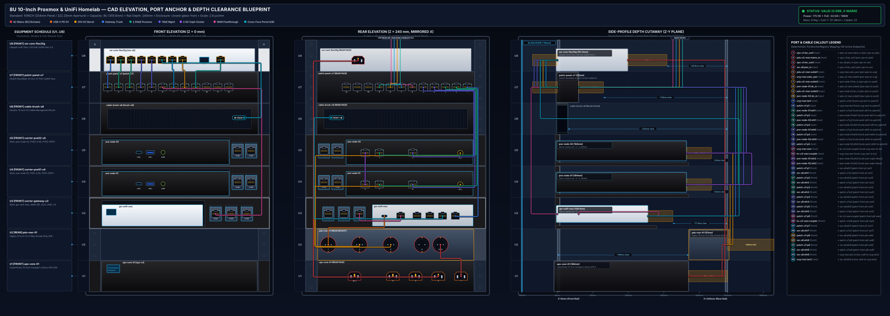
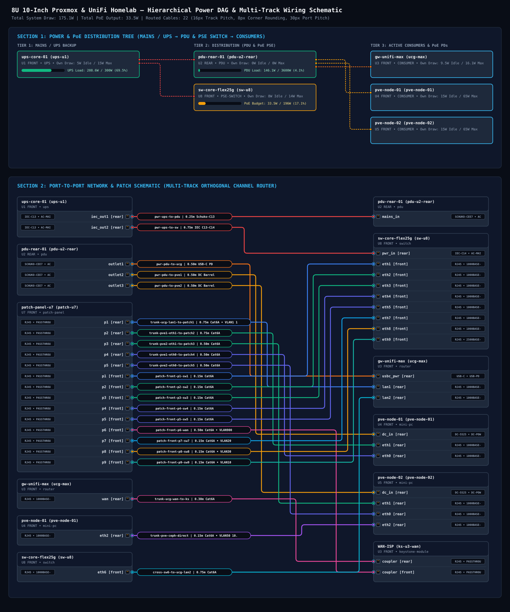

<div align="center">

# 🏗️ RackArchitect MCP (`@rack-mcp/*`)

**The Open-Source, Agent-First "Rack-as-Code" Planning, 5-Stage Validation, Parametric 3D-Print (`.scad`/`.stl`) & Live 2D/3D CAD Platform for 19-Inch Enterprise Racks, 10-Inch Mini-Racks & 6-Inch Micro-Homelabs**

[](./LICENSE)
[](https://glama.ai/mcp/servers/itAlex240/rack-architect-mcp)
[](https://mcpservers.org/servers/italex240/rack-architect-mcp)
[](https://italex240.github.io/rack-architect-mcp/)
[](./tsconfig.base.json)
[](./packages/mcp-server)
[-EC4899.svg)](./skills/rack-architect/SKILL.md)
[](./ARCHITECTURE.md)
[](./packages/exporters/src/openscad-carrier.ts)
[](https://rack-mcp.167.233.80.33.sslip.io/mcp)
[](./vitest.config.ts)

[**🌐 Launch Live 3D/2D Browser Demo**](https://italex240.github.io/rack-architect-mcp/) · [**Quickstart**](#-30-second-quickstart) · [**MCP Client & Agent Skill**](#-connect-claude-desktop-cursor-or-antigravity) · [**3D-Print (.SCAD / .STL)**](#-parametric-3d-print-generator-scad--stl) · [**Add Hardware Blueprint**](./CONTRIBUTING.md) · [**Complete Handbook (DE)**](./docs/COMPLETE_SYSTEM_HANDBOOK.md)

</div>

---

## 🎯 Why RackArchitect MCP? (The Three Golden Laws)

Planning a compact **10-inch mini-rack** (e.g., DeskPi RackMate T1/T2, Digitus SOHO) or a dense **19-inch homelab** with AI agents used to fail for one reason: **LLMs hallucinate physical geometry.** They forget that a `55 mm` Schuko plug on a rear PDU collides with a `182 mm` Lenovo ThinkCentre M920q mounted in front, or that two fanless PoE switches stacked together create a thermal hotspot.

**RackArchitect MCP** solves this with three non-negotiable engineering laws:

1. **LLMs Never Guess Geometry:** Every spatial coordinate (`1 U = 44.45 mm`), 3D Axis-Aligned Bounding Box (`B_chassis` + dynamic plug clearance $\Delta Z_{\text{plug}}$), Catmull-Rom 3D cable spline, PoE budget DAG, and logarithmic `dB(A)` acoustic sum is computed deterministically in millimeters by `@rack-mcp/core-domain`.
2. **Single Source of Truth (`rack.yaml`):** Your entire rack state (devices, 3D-printed sub-U carrier slots, child mini-PCs, keystone couplers, cables, VLANs, and IP CIDRs) lives in a single, Git-friendly YAML file.
3. **Actionable Self-Correction Feedback:** Whenever a placement or cable fails any of the **5 validation stages** (26 closed `DiagnosticCode` types), the engine returns structured `remediation_suggestions` so your AI agent fixes the collision, PoE overload, or `Cat5e` bottleneck autonomously in the very next turn.

---

## 🖼️ Generated CAD Blueprints (100% Deterministic SVG Output)

### 1. Dual-Row Engineering Elevation & Z-Depth Side Cutaway (`elevation.svg`)
Includes Equipment Schedule, Front Elevation (`X, Y`), Horizontally Mirrored Rear Elevation (`W_panel - X - width`), Cable Callout Lanes, and Right-Hand Z-Depth Cutaway (`Z_min` to `Z_max` with Front Glass Door `-50 mm` and Rear Wall `+300 mm` clearance checks):

<p align="center">
  
</p>

### 2. 5-Layer Logical Pin-to-Pin Wiring Schematic with VLAN & IP CIDR Badges (`wiring-schematic.svg`)

<p align="center">
  
</p>

---

## 🚀 30-Second Quickstart

### Option A: Local Node.js (`>= 20`) & `pnpm`

```bash
# 1. Clone & install
git clone https://github.com/itAlex240/rack-architect-mcp.git
cd rack-architect-mcp
pnpm install

# 2. Build all 6 packages & run the 34 test suites
pnpm build
pnpm test

# 3. Launch the Live 3D/2D Web-Viewer & Sidecar on the 8U 10-Inch Reference Homelab
pnpm start
```

Open **`http://127.0.0.1:3100/`** in your browser to inspect the 3D Digital Twin, mount devices from the Catalog Drawer, route 3D spline cables, and download `.SCAD` / `.STL` / `.GLB` / `.SVG` / `BOM.md` deliverables!

### Option B: Docker (Zero Local Dependencies)

```bash
# Run the pre-built image from GitHub Container Registry:
docker run --rm -p 3100:3100 ghcr.io/italex240/rack-architect-mcp:latest

# Or build locally:
docker build -t rack-architect-mcp .
docker run --rm -p 3100:3100 rack-architect-mcp
# Open http://127.0.0.1:3100/
```

### Option C: CLI Validation & Headless CAD Export

```bash
# Validate any rack.yaml and print the ASCII Elevation Plan + Diagnostics
pnpm validate:demo

# Export elevation.svg, wiring-schematic.svg, BOM.md, rack-scene.glb, and all .scad + .stl 3D-print carriers
pnpm export:demo
```

---

## 🤖 Connect Claude Desktop, Cursor, or Antigravity

### Option 1: Zero-Install Hosted Remote MCP (`Streamable HTTP` — Instant 1-URL Setup)

Connect any modern MCP client (Claude, Cursor, VS Code Copilot, Windsurf, Google Antigravity, MCP Inspector) directly over HTTPS without installing Node.js or Docker locally:

```json
{
  "mcpServers": {
    "rack_architect_mcp": {
      "url": "https://rack-mcp.167.233.80.33.sslip.io/mcp"
    }
  }
}
```

- **Strict Multi-Session Isolation:** Every connecting MCP client receives its own isolated in-memory session (`Mcp-Session-Id`) and a dedicated **Live 3D Digital Twin URL** (`https://rack-mcp.167.233.80.33.sslip.io/?session=<uuid>`) that streams every AI tool mutation in real time over `wss://`!
- *(Legacy HTTP+SSE clients can also connect via `https://rack-mcp.167.233.80.33.sslip.io/sse`.)*

### Option 2: Local `stdio` + Local WebSocket Sidecar (`127.0.0.1:3100`)

Add `rack_architect_mcp` to your `claude_desktop_config.json`, `.cursor/mcp.json`, or Antigravity MCP settings:

```json
{
  "mcpServers": {
    "rack_architect_mcp": {
      "command": "node",
      "args": [
        "/ABSOLUTE/PATH/TO/rack-architect-mcp/packages/cli/dist/bin.js",
        "--stdio",
        "--port",
        "3100",
        "--project",
        "/ABSOLUTE/PATH/TO/rack-architect-mcp/examples/10inch-homelab/rack.yaml"
      ]
    }
  }
}
```

Whenever your AI agent starts the MCP server over `stdio`, it **automatically launches the local WebSocket Sidecar at `http://127.0.0.1:3100`**. Every tool call the AI executes (`mount_equipment`, `connect_cables`, `modify_equipment`, `undo_redo`) updates your 3D browser view in real time!

### 🧠 Official Open-Source Agent Skill ([`skills/rack-architect/SKILL.md`](./skills/rack-architect/SKILL.md))

This repository includes a **100% free, MIT-licensed Agent Skill** ([`skills/rack-architect/SKILL.md`](./skills/rack-architect/SKILL.md) & [`.agents/skills/rack-architect/SKILL.md`](./.agents/skills/rack-architect/SKILL.md)) that teaches Claude Code, Cursor, GitHub Copilot, and Google Antigravity the complete **6-Phase Autonomous Rack Engineering Runbook** (sub-U modular carrier pairing, `-angled` plug selection, all 26 diagnostic remediation patterns, and 2-manifold `.STL` export):

```bash
# Install the skill into Claude Code, Cursor, Copilot, or Windsurf via skills CLI:
npx skills add itAlex240/rack-architect-mcp

# Or in Google Antigravity: automatically discovered from .agents/skills/rack-architect/SKILL.md!
```

---

## 🖨️ Parametric 3D-Print Generator (`.scad` & `.stl`)

For every modular 3D-printed carrier (`category: 'modular-carrier'`), `@rack-mcp/exporters` automatically generates:
1. **Parametric OpenSCAD (`.scad`):** Customizable wall thickness, EIA-310 oval rack ears (`9.5 × 6.5 mm`), sub-U device bays (`+0.35 mm` tolerance for Lenovo ThinkCentre M920q, Ubiquiti UCG-Max, JetKVM), Keystone snap-in clips, side support rails, and rear PSU brick cradles with Velcro slots.
2. **Ready-to-Slice Watertight ASCII `.stl`:** Computed directly in memory via 2D grid subdivision—drop straight into **OrcaSlicer**, **Bambu Studio**, or **PrusaSlicer**!

Pre-generated reference files in [`examples/10inch-homelab/`](./examples/10inch-homelab/):
- [`3dprint-10inch-lenovo-tiny-plus-2keystone.scad`](./examples/10inch-homelab/3dprint-10inch-lenovo-tiny-plus-2keystone.scad) & [`.stl`](./examples/10inch-homelab/3dprint-10inch-lenovo-tiny-plus-2keystone.stl)
- [`3dprint-10inch-ucg-ultra-plus-3keystone.scad`](./examples/10inch-homelab/3dprint-10inch-ucg-ultra-plus-3keystone.scad) & [`.stl`](./examples/10inch-homelab/3dprint-10inch-ucg-ultra-plus-3keystone.stl)
- [`3dprint-10inch-cover-panel-lines-1u.scad`](./examples/10inch-homelab/3dprint-10inch-cover-panel-lines-1u.scad) & [`.stl`](./examples/10inch-homelab/3dprint-10inch-cover-panel-lines-1u.stl)
- [`3dprint-10inch-cover-panel-hex-1u.scad`](./examples/10inch-homelab/3dprint-10inch-cover-panel-hex-1u.scad) & [`.stl`](./examples/10inch-homelab/3dprint-10inch-cover-panel-hex-1u.stl)
- [`3dprint-10inch-cover-panel-lines-2u.scad`](./examples/10inch-homelab/3dprint-10inch-cover-panel-lines-2u.scad) & [`.stl`](./examples/10inch-homelab/3dprint-10inch-cover-panel-lines-2u.stl)
- [`3dprint-10inch-cover-panel-ribs-2u.scad`](./examples/10inch-homelab/3dprint-10inch-cover-panel-ribs-2u.scad) & [`.stl`](./examples/10inch-homelab/3dprint-10inch-cover-panel-ribs-2u.stl)

---

## 🖥️ Live 3D Digital Twin & 2D CAD Web-Viewer (`127.0.0.1:3100`)

- **Interactive Catalog & Cable Patch Builder (`+ Catalog & Cable Builder`):**
  - Search all 67 hardware blueprints, filter by `10inch` / `19inch` / `6inch` / `sub-module`, select `Target U` + `FRONT/REAR`, and mount with 1 click.
  - Patch 3D Catmull-Rom cables between any two ports with optional `VLAN ID` (`1..4094`) and `IP CIDR` (`10.10.20.0/24`) annotations.
- **3D Engineering HUD:**
  - Camera Presets: `Perspective`, `Front Ortho`, `Rear Ortho`, `Left Cutaway`
  - Toggles: `X-Ray Chassis` (inspect internal mini-PCs & PSU bricks), `Clearance Boxes` ($\Delta Z_{\text{plug}}$ wireframes), `Cable Splines`
  - `Explode Z (0..140 mm)` slider to separate front and rear assemblies
- **W3C WebMCP Ready:** Automatically registers all 12 tools on `document.modelContext` when opened in a WebMCP-capable browser.

---

## 🛡️ 5-Stage Validation Engine (All 26 Diagnostic Codes)

| Stage | Diagnostic Codes | What Is Checked Deterministically? |
| :--- | :--- | :--- |
| **1. Bounds & Slots** | `CODE_DUPLICATE_INSTANCE_ID`, `CODE_UNKNOWN_BLUEPRINT`, `CODE_RACK_BOUNDS_EXCEEDED`, `CODE_SLOT_NOT_FOUND`, `CODE_SLOT_OCCUPIED`, `CODE_SLOT_BOUNDS_EXCEEDED` | Rack U height, panel width (`19"`, `10"`, `6"`), sub-U carrier slot dimensions (`mm`) and allowed categories. |
| **2. 3D AABB & Doors** | `CODE_CHASSIS_COLLISION`, `CODE_CLEARANCE_COLLISION`, `CODE_FRONT_DOOR_VIOLATION`, `CODE_REAR_CLEARANCE_VIOLATION` | Millimeter-exact 3D AABB overlap between front and rear equipment including dynamic plug clearances (`schuko-cee7 = 55 mm`, `iec-c13 = 45 mm`, `sfp+ = 38 mm`, `rj45 = 35 mm`). |
| **3. Power & PoE DAG** | `CODE_POE_BUDGET_EXCEEDED`, `CODE_MISSING_POWER_INPUT`, `CODE_EXTERNAL_PSU_UNPLUGGED`, `CODE_PDU_OVERLOAD` | Full electrical DAG from UPS/PDU to switches, external power bricks (Lenovo 135W Slim-Tip), and PoE PSE/PD budgets (`196 W`). |
| **4. Cables & Speed** | `CODE_PORT_NOT_FOUND`, `CODE_PORT_ALREADY_OCCUPIED`, `CODE_PORT_INCOMPATIBLE`, `SPEED_MISMATCH`, `CODE_MISSING_CABLE_PORTAL`, `CODE_CABLE_BEND_RADIUS_VIOLATION` | Connector compatibility, `Cat5e` bottleneck detection on $\ge 2.5\text{ GbE}$ links (`SPEED_MISMATCH`), front-to-rear brush portal checks, and minimum 3D spline bend radius. |
| **5. Thermal & Acoustic** | `THERMAL_AIRFLOW_CONFLICT`, `THERMAL_HOTSPOT_STACKING`, `CODE_THERMAL_DENSITY_HIGH`, `ACOUSTIC_NOISE_HIGH`, `CODE_WEIGHT_LIMIT_WARNING` | Opposing airflow (`front-to-rear` vs `rear-to-front`), stacked high-power fanless switches, `BTU/hr` heat load, and logarithmic `dB(A)` noise addition ($L_{\text{total}} = 10 \log_{10}(\sum 10^{L_i/10})$). |

---

## 📦 Monorepo Architecture (`packages/*`)

| Package | Description |
| :--- | :--- |
| [`@rack-mcp/core-domain`](./packages/core-domain) | Pure TypeScript/Zod schemas, 3D coordinate transformer, AABB collision solver, 5-stage validator, and clamped Catmull-Rom 3D spline router (zero Node/DOM dependencies). |
| [`@rack-mcp/hardware-catalog`](./packages/hardware-catalog) | 67 YAML hardware blueprints (`10inch`, `19inch`, `6inch`, `carriers`, `sub-modules`), `port_groups` matrix expander, and catalog search/validator. |
| [`@rack-mcp/exporters`](./packages/exporters) | `elevation.svg`, `wiring-schematic.svg`, `BOM.md`, headless binary `.glb`, and parametric `.scad` & `.stl` 3D-print generators. |
| [`@rack-mcp/mcp-server`](./packages/mcp-server) | MCP server (`stdio`), 12 tools, 4 resources, 2 prompts, 50-step Undo/Redo manager, and local HTTP/WebSocket sidecar (`:3100`). |
| [`@rack-mcp/web-viewer`](./packages/web-viewer) | React 19 + Three.js (`@react-three/fiber`) live 3D/2D CAD studio, Catalog/Cable Builder Drawer, and W3C WebMCP integration. |
| [`@rack-mcp/cli`](./packages/cli) | Unified `rack-mcp` CLI (`serve`, `validate`, `export`). |

---

## 🤝 Contributing & Adding Hardware Blueprints

Want to add your favorite 10-inch switch, mini-PC, or 3D-printed carrier? You can add a new YAML blueprint in under 2 minutes—see [**CONTRIBUTING.md**](./CONTRIBUTING.md)!

## 📄 License

Released under the [**MIT License**](./LICENSE).
