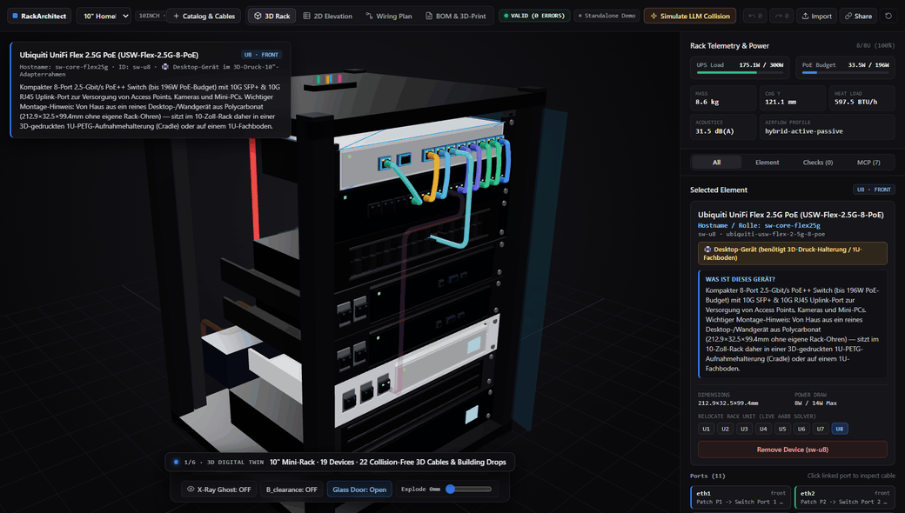

<div align="center">

# 🏗️ RackArchitect MCP `v0.7.8` — 3D/2D Rack Planner, Hosted Remote MCP (`mcp.rackarchitect.dev`), CAD Blueprints & 3D-Print Package (`.STL`)

**Welcome to RackArchitect MCP `v0.7.8`!**  
Whether you are a **complete beginner with zero coding experience** who just wants to plan a compact 10-inch mini-rack or 19-inch server rack in your browser and 3D-print custom modular brackets, or an **AI / DevOps engineer** orchestrating racks via our **zero-install Hosted Remote MCP endpoint (`https://mcp.rackarchitect.dev/mcp`)** — everything is explained step by step below (**English first, followed by the full German version / Deutsche Version weiter unten**).

<p align="center">
  <a href="https://mcp.rackarchitect.dev/">
    
  </a>
</p>

> **✨ What's New in the Last 3 Releases (`v0.7.6` – `v0.7.8`):**
> - **CodeQL Full HTML/Markdown Sanitization & Grouped Dependabot Updates (`v0.7.8`):** Resolved the GitHub CodeQL High Alert (`js/incomplete-sanitization`) in `bom-markdown.ts` by escaping all special characters (`&`, `<`, `>`, `"`, `'`) and table backslashes/pipes, consolidated Dependabot updates into 3 atomic groups (`production-dependencies`, `dev-dependencies`, `github-actions`), locked TypeScript to semver-minor to protect TS 5.9 compiler gates, and closed failing PRs.
> - **Dual Security Audit Hardening, 10x Faster 3D Cable Router & Read-Only Viewer Token Isolation (`v0.7.7`):** Separated public HMAC-SHA256 `viewerToken` URLs (`/?session=<viewerToken>`) from the write-capable `Mcp-Session-Id` header, enforced read-only remote viewer WebSockets (`60 commands/min` limit), confined local `export_deliverables` `output_dir` to the project workspace (with `fs.realpathSync` symlink checks), added local DNS-rebinding `Host` header guards (`421`), tightened proxy trust & IPv6 `/64` rate-limit bucketing, removed `saltHex` persistence from `telemetry.json`, and accelerated 3D Catmull-Rom cable routing via 3D AABB culling and collinear spline compaction.
> - **Accurate Remote MCP Crawler Telemetry, Idle Probe Session Cleanup & Resilient Registry Publishing (`v0.7.6`):** Automated MCP directory crawlers and liveness monitors (`mcpbeat`, `AgentRankProbe`, `SealKeeperBot`, `EveryMCP-Probe`, `mcptry.com`, …) are now counted as `registry-probe` instead of inflating `other-mcp` on the Grafana dashboard, never-used crawler sessions are released after `10 min` idle instead of `2 h`, and the MCP Registry publish step now retries up to 5 times.

<details>
<summary>🗄️ <b>View Earlier Releases (v0.1.0 – v0.7.5) in the Release Archive</b></summary>

<br />

- **`v0.7.5`** — Precision 5/5 TDQS MCP Tool Descriptions Across All 12 Tools (`search_catalog`, `export_deliverables`, `init_rack`, `define_custom_blueprint`, `undo_redo`).
- **`v0.7.4`** — Synchronized Agent Skill (`SKILL.md`), 5 EIA-310 Archetypes (`10"`/`19"`/`6"`) & 100% exact schema/prompt parity across all 21 diagnostic codes, 20 cable types, and 67 blueprints.
- **`v0.7.3`** — Official Dual-Stack HTTPS domain `https://mcp.rackarchitect.dev` (`/mcp`, `/sse`, `/?session=<uuid>`) & multi-origin CSWSH/CORS compatibility for legacy `sslip.io` links.
- **`v0.7.2`** — Collision-free rear-cavity 3D cable routing (`resolveEffectivePortZone`), detour-aware open-`U` pass-through portal scoring, true 3D `(z, y)` 2D Side-Cutaway projection & 2-Section 3-Tier Power/PoE DAG + Multi-Track Wiring Plan.
- **`v0.7.1`** — Crisp 6-scene animated 3D/2D Hero showcase GIF (`docs/assets/rack-architect-hero-demo.gif`) embedded in `README.md` and Release Notes.
- **`v0.7.0`** — Privacy-first GDPR-compliant Remote MCP usage, active AI client & wire-traffic telemetry (`GET /metrics` Prometheus & `GET /api/telemetry` JSON with salted HMAC-SHA256 `Today`/`7d`/`30d` visitor deduplication).
- **`v0.6.7`** — GitHub Actions `.mcpb` release bundling fix, dual `mcpb` + Hosted Remote MCP `server.json` manifest & CodeQL `javascript-typescript` security/quality hardening.
- **`v0.6.6`** — Instant Zero-Install Remote MCP quickstart & endpoint table across GitHub `README.md`, `glama.json`, `server.json`, package READMEs, `SKILL.md`, and Release Notes.
- **`v0.6.5`** — Multi-agent operational handover (`CLAUDE.md`, `GEMINI.md`, `AGENTS.md` Section 10), Zero-Egress DMZ invariants & automated Zero-Downtime GitHub `main` pull-deployments with Trivy CVE gating.
- **`v0.6.4`** — Multi-tenant fair-share per-IP session isolation, WebSocket `256 KB` frame & CSWSH `Origin` guards, strict `Content-Security-Policy` + scoped CORS, algorithmic DoS schema bounds & `root:root`-owned Docker runtime binaries.
- **`v0.6.3`** — Workspace-aware Zero-CVE Docker production build (`pnpm install --prod`) & build-time CLI validation smoke check (`0` High/Critical Trivy CVEs).
- **`v0.6.2`** — Headless CI Docker pruning (`ENV CI=true`) & sourcemap/esbuild cleanup in the minimal `node:22-alpine` runtime stage.
- **`v0.6.1`** — Zero-CVE production Docker runtime hardening (~350 MB smaller image, `0` High/Critical Trivy CVEs).
- **`v0.6.0`** — Zero-install Hosted Multi-Session Remote MCP Server (`Streamable HTTP` `/mcp` & `SSE` `/sse`), isolated Live 3D Session Viewer (`/?session=<uuid>`), zero-disk HTTPS deliverable downloads & per-IP rate limiting.
- **`v0.5.0`** — Live Rack Preset Switcher (`10"` · `19"` · `6"` · `Empty`), shareable zero-backend rack links (`#rack=v1...`), custom 3D-print cover-panel configurator (`0.5U`–`3U` + engraved front text) & direct 2-click 3D port patching.
- **`v0.4.12`** — 7 3D-printable Designer Slot Cover Panels (`1U` & `2U` • `Lines` / `Hex` / `Tech-Ribs`), closed `U2 Front` slot above UPS & watertight `.SCAD`/`.STL` generators.
- **`v0.4.11`** — Top-rear external ISP fiber WAN & PoE+ building cable drops (`ext-isp-wan`, Wi-Fi 7 AP, 4K PoE+ camera, 2.5G office LAN) in the GitHub Pages Demo, 3D roof conduit collar & 2D/GLB exporters.
- **`v0.4.10`** — TDQS Tier-A overhaul across all 12 MCP tools, documented `outputSchema` contracts (`structuredContent`), 100% recursive parameter descriptions, full MCP behavioral annotations & server-level `instructions`.
- **`v0.4.9`** — 30 new hardware blueprints across `10inch`, `19inch`, and `6inch` racks (catalog doubled to 60 parts) + 3D/2D multi-bay hot-swap NAS sleds and ventilated cantilever shelves.
- **`v0.4.8`** — Shortest-direct monotonic 3D cable routing by default (`routing_mode: 'shortest-direct'`) & optional side-duct overrides (`20%–55%` shorter cable paths).
- **`v0.4.7`** — Consistent English-first, German-second release notes, archive & changelog structure.
- **`v0.4.6`** — Zero cable-through-rail penetration, convex-hull De Casteljau corner fillets & clean rear/top conduit routing.
- **`v0.4.5`** — Automated GitHub Releases page curation (retaining top 3 releases) & [`docs/RELEASE_ARCHIVE.md`](https://github.com/itAlex240/rack-architect-mcp/blob/main/docs/RELEASE_ARCHIVE.md).
- **`v0.4.4`** — Real-world ANSI/TIA-942 & Homelab schematics, 1:1 vertical port alignment (`p1..p24 <-> eth1..eth24`) & 4 use-case archetypes in `SKILL.md`.
- **`v0.4.3`** — Human-readable device descriptions ("What is this device?"), full Manufacturer + Model titles & 3D-printed desktop switch adapter cradles (`USW-Flex-2.5G-8-PoE`).
- **`v0.4.2`** — Eliminated horizontal text clipping in the right `InspectorSidebar` (`minmax(0, 1fr)`) and `TopNavBar`.
- **`v0.4.1`** — 100% collision-free 3D cable routing (`0` cable-to-cable interpenetrations via `computeMinSplineClearanceMm`).
- **`v0.4.0`** — External building/room cable drops (`plan_external_endpoints`), visible 3D ports on protruding faceplates & segmented 3D nylon brush panels.
- **`v0.3.0` – `v0.3.3`** — "Precision Hardware & CAD Studio" UI/UX redesign, dedicated local MCP Engineering Workbench (`localhost:3100`) & coaxial plug entry splines.
- **`v0.1.0` – `v0.2.0`** — Core domain engine, 5-stage validation solver, 30 hardware blueprints, SVG/BOM/GLB/OpenSCAD/STL exporters & MCP server.

👉 Full History: [**`docs/RELEASE_ARCHIVE.md`**](https://github.com/itAlex240/rack-architect-mcp/blob/main/docs/RELEASE_ARCHIVE.md) · [**`CHANGELOG.md`**](https://github.com/itAlex240/rack-architect-mcp/blob/main/CHANGELOG.md)

</details>

</div>

<!-- BEGIN_QUICKSTART_GUIDE -->

---

## 🇬🇧 English Quick-Start Guide (Zero Installation Required!)

### 🌐 Option 1: Try the 3D/2D Rack Planner Directly in Your Browser
You **do not need to download or install anything**. Simply click this link:

> ### 👉 [**Click Here: Launch the Interactive 3D/2D Rack Planner in Your Browser**](https://italex240.github.io/rack-architect-mcp/)

**What can you do with your mouse?**
1. **Orbit & Zoom in 3D:** Hold the **left mouse button** to rotate around the rack from any angle, and use the **scroll wheel** to zoom in on ports and cables.
2. **Look Inside (`X-Ray` & `Explode`):** Use the bottom dock to toggle **`X-Ray Chassis`** (makes enclosures translucent) or drag the **`Explode Z`** slider (separates front and rear equipment so every internal plug is visible).
3. **Mount Your Own Gear & Route Cables:** Click **`+ Catalog & Cable Builder`** in the top-left corner:
   - Pick any device (Mini-PC, switch, PDU, UPS, or 3D-printed carrier), choose a rack unit (`U1`–`U8`), and click **`+ Mount`**.
   - The engine immediately checks for depth collisions, power/PoE budgets, and thermal constraints!
4. **Switch Between 3D, CAD Blueprints & BOM:** Use the top-center switcher to view:
   - **`3D Digital Twin`** (Interactive 3D view)
   - **`2D Elevation CAD`** (True-to-scale Front, Rear & Side Z-Depth Cutaway drawing)
   - **`2D Wiring Schematic`** (Color-coded Pin-to-Pin cable wiring diagram)
   - **`BOM & 3D-Print Hub`** (Complete shopping list + 1-click `.STL` / `.SCAD` downloads for your 3D printer)

---

### 📦 Option 2: What Are the 9 Downloadable Files Under "Assets" Below?

At the very bottom of this release page under **"Assets"**, you will find **9 ready-to-use files**. Here is what each file is for:

| File Under "Assets" | Who Is It For? | What Is It & How Do I Open It? |
| :--- | :--- | :--- |
| 🖨️ **`3dprint-10inch-lenovo-tiny-plus-2keystone.stl`** | **3D Printer Owners** | **Ready-to-print 3D bracket** for a 1-Liter Mini-PC (Lenovo ThinkCentre M920q / Dell Micro) + 2 Keystone ports in a 10-inch rack. Drag directly into **Bambu Studio**, **OrcaSlicer**, **PrusaSlicer**, or **Cura** and print! *(Tip: PETG/ASA filament, lay flat on the front faceplate, zero supports required).* |
| 🖨️ **`3dprint-10inch-ucg-ultra-plus-3keystone.stl`** | **3D Printer Owners** | **Ready-to-print 3D bracket** for a Ubiquiti UniFi Cloud Gateway (`UCG-Max` / `UCG-Ultra`) + 3 Keystone ports in a 10-inch rack. Open directly in your slicer and print! |
| 🔧 **`...scad` (2 files)** | **Makers & CAD Users** | Parametric **[OpenSCAD](https://openscad.org/) source files** for the two 3D-printed brackets if you want to customize wall thickness or hole tolerances. |
| 📐 **`elevation.svg`** | **Everyone (CAD Plan)** | **True-to-scale 2D CAD Elevation Plan** (Front view, Rear view, and Side Z-depth cutaway). Simply **double-click** after downloading — it opens in any web browser (Chrome, Edge, Firefox, Safari) with infinite crisp zoom. |
| 🔌 **`wiring-schematic.svg`** | **Everyone (Wiring Plan)** | **Pin-to-Pin Cable Wiring Diagram.** Shows with color-coded lines exactly which power and network cable plugs into which socket. **Double-click to open in any browser.** |
| 🛒 **`BOM.md`** | **Shopping & Parts List** | **Complete Bill of Materials** (opens in any text/Markdown editor). Lists all devices, required screws (`M6` cage nuts, `M3` fasteners), 3D-print filament weight in grams, and **exact commercial cable lengths**. |
| 🧊 **`rack-scene.glb`** | **3D Viewers / Blender** | Complete **3D model of the populated rack** as a single binary glTF file. Open in Windows/macOS 3D viewers, PowerPoint, or **Blender**. |
| 📄 **`rack.yaml`** | **Project Save File** | Declarative YAML source file defining the complete 8U reference homelab rack. |

---

### 🤖 Option 3: Connect Any AI Agent Instantly via Hosted Remote MCP (Zero Install!)

Connect Claude, Claude Code, Cursor, VS Code Copilot, Windsurf, or Google Antigravity directly via URL — **no Node.js or Docker installation required**, and every AI session automatically gives you a real-time **Live 3D Digital Twin URL** (`https://mcp.rackarchitect.dev/?session=<uuid>`):

```json
{
  "mcpServers": {
    "rack_architect_mcp": {
      "url": "https://mcp.rackarchitect.dev/mcp"
    }
  }
}
```

```bash
# Or add in 1 second via Claude Code CLI (legacy SSE also available at /sse):
claude mcp add --transport http rack_architect_mcp https://mcp.rackarchitect.dev/mcp

# Or self-host locally with Docker:
docker build -t rack-architect-mcp https://github.com/itAlex240/rack-architect-mcp.git
docker run --rm -p 3100:3100 rack-architect-mcp
```

---

## 🇩🇪 Deutsche Version — Release Notes & Einsteiger-Anleitung

**Willkommen beim Release `v0.7.8` von RackArchitect MCP!**  
Egal ob du **gar nicht programmieren kannst** und einfach nur deinen kleinen Netzwerkschrank / 10-Zoll-Mini-Rack im Browser planen oder eine Halterung auf deinem 3D-Drucker ausdrucken möchtest, oder deinen KI-Assistenten direkt per **Remote-MCP-URL (`https://mcp.rackarchitect.dev/mcp`)** verbindest — hier steht Schritt für Schritt in einfacher Sprache, was du tun musst.

> **✨ Was ist neu in den letzten 3 Versionen (`v0.7.6` – `v0.7.8`):**
> - **CodeQL-HTML/Markdown-Vollmaskierung & gruppierte Dependabot-Updates (`v0.7.8`):** Vollständige Behebung des CodeQL-High-Alerts (`js/incomplete-sanitization`) in `bom-markdown.ts` durch vollständiges Encoding (`&`, `<`, `>`, `"`, `'`) und Backslash-Escaping vor Tabellen-Pipes, Zusammenfassung von Dependabot-Updates in 3 logische Gruppen (`production-dependencies`, `dev-dependencies`, `github-actions`), Ausschluss von TypeScript-Major-Versionen zur Wahrung der TS 5.9 Compiler-Gates und Schließen fehlerhafter PRs.
> - **Security-Audit-Härtung, 10x schnelleres 3D-Kabel-Routing & Read-Only Viewer-Token (`v0.7.7`):** Getrennte HMAC-SHA256-`viewerToken` für geteilte Live-3D-Viewer-Links (`/?session=<viewerToken>`), Schreibschutz für unauthentifizierte Remote-Viewer-WebSockets (`60 Befehle/Min.`), strikte Projektverzeichnis-Prüfung inkl. Symlink-Schutz bei lokalem `export_deliverables`, DNS-Rebinding-Schutz (`421`) am lokalen Sidecar, verschärftes Proxy-Trust- & IPv6-`/64`-Rate-Limiting, keine Speicherung des Telemetrie-HMAC-Schlüssels auf der Festplatte sowie 10x schnelleres 3D-Spline-Routing durch 3D-AABB-Culling und Segment-Kompaktierung.
> - **Korrekte Crawler-Statistik, schnellere Bereinigung ungenutzter Sessions & robuster Registry-Upload (`v0.7.6`):** Automatische MCP-Verzeichnis-Crawler und Erreichbarkeits-Checker (`mcpbeat`, `AgentRankProbe`, `SealKeeperBot`, `EveryMCP-Probe`, `mcptry.com` …) zählen jetzt als `registry-probe` statt `other-mcp` im Grafana-Dashboard, ungenutzte Crawler-Sessions werden nach `10 Min.` statt `2 Std.` freigegeben und der MCP-Registry-Upload versucht es bis zu 5-mal erneut.

<details>
<summary>🗄️ <b>Ältere Versionen (v0.1.0 – v0.7.5) auf Deutsch anzeigen</b></summary>

<br />

- **`v0.7.5`** — TDQS-5/5-Feinschliff aller 12 MCP-Tool-Beschreibungen (`search_catalog`, `export_deliverables`, `init_rack`, `define_custom_blueprint`, `undo_redo`).
- **`v0.7.4`** — Aktualisierter AI-Agent-Skill (`SKILL.md`), 5 Rack-Archetypen (`10"`/`19"`/`6"`) & 100 % Schema-/Prompt-Abgleich über alle 21 Diagnose-Codes, 20 Kabeltypen und 67 Blueprints.
- **`v0.7.3`** — Offizielle Dual-Stack-HTTPS-Domain `https://mcp.rackarchitect.dev` (`/mcp`, `/sse`, `/?session=<uuid>`) & Multi-Origin-CSWSH/CORS für bestehende `sslip.io`-Links.
- **`v0.7.2`** — Kollisionsfreie 3D-Innenraum-Kabelführung (`resolveEffectivePortZone`), automatische Open-`U`-Portalwahl, echter 3D-Seitenschnitt & 2-teiliger 3-Stufen-Strom-/PoE-Baum + Multi-Track-Kabelplan.
- **`v0.7.1`** — Gestochen scharfes, animiertes 6-Szenen 3D/2D Hero-Demo-GIF (`docs/assets/rack-architect-hero-demo.gif`) in `README.md` und den Release Notes.
- **`v0.7.0`** — DSGVO-konformer MCP-Nutzungs-, KI-Client- & Traffic-Tracker (`GET /metrics` Prometheus & `GET /api/telemetry` JSON mit gesalzenem HMAC-SHA256 ohne Speicherung echter IPs).
- **`v0.6.7`** — Fix der GitHub-Actions-`.mcpb`-Release-Pipeline, kombiniertes `mcpb`- + Remote-MCP-`server.json`-Manifest & Behebung aller CodeQL-Code-Scanning-Befunde.
- **`v0.6.6`** — Direkter Zero-Install Remote-MCP-Schnellstart & Endpunkt-Übersicht oben in der `README.md`, `glama.json`, `server.json`, den Paket-READMEs, `SKILL.md` und den Release Notes.
- **`v0.6.5`** — Multi-Agenten-Übergaberegeln (`CLAUDE.md`, `GEMINI.md`, `AGENTS.md` Abschnitt 10), Zero-Egress-DMZ-Invarianten & automatischer Zero-Downtime Auto-Updater vom GitHub-`main`-Branch inkl. Trivy-CVE-Gate.
- **`v0.6.4`** — Fair-Share-Mandantenschutz pro IP (`maxSessionsPerIp = 12`), `256 KB` WebSocket-Frame-Limit + CSWSH-`Origin`-Prüfung, strikte `Content-Security-Policy` + Scoped CORS, DoS-Schema-Obergrenzen & `root:root`-Code-Schutz im Docker-Container.
- **`v0.6.3`** — Workspace-fähiger Zero-CVE Docker-Produktions-Build (`pnpm install --prod`) inkl. automatischem CLI-Selbsttest (`0` High/Critical Trivy-CVEs).
- **`v0.6.2`** — Headless Docker-Build-Fix (`ENV CI=true`) & Bereinigung von Sourcemaps/`esbuild`-Resten im schlanken `node:22-alpine`-Produktions-Image.
- **`v0.6.1`** — Zero-CVE Docker-Runtime-Härtung (~350 MB schlankeres Produktions-Image, `0` High/Critical Trivy-CVEs).
- **`v0.6.0`** — Gehosteter Multi-Session Remote-MCP-Server (`Streamable HTTP` `/mcp` & `SSE` `/sse`), eigener Live-3D-Session-Viewer (`/?session=<uuid>`), sichere HTTPS-Download-URLs ohne Server-Dateizugriff & IP-Rate-Limiting.
- **`v0.5.0`** — Live-Preset-Switcher (`10"` · `19"` · `6"` · `Leer`), teilbare Rack-Links (`#rack=v1...`), interaktiver 3D-Druck-Cover-Panel-Konfigurator (`0.5U`–`3U` + Gravur-Text) & direktes 2-Klick-3D-Port-Patching.
- **`v0.4.12`** — 7 neue 3D-druckbare Designer-Cover-Panels (`1U` & `2U` • `Linien` / `Waben` / `Tech-Rippen`), geschlossener `U2 Front`-Slot über der USV & 2-Manifold `.SCAD`/`.STL`-Dateien.
- **`v0.4.11`** — Externe Zuführungskabel von oben (ISP-Glasfaser-WAN, PoE+ Überwachungskamera, PoE+ Wi-Fi 7 AP & 2.5G Büro-LAN) in der GitHub-Pages-Demo, 3D-Dachkabeleinlass & 2D/GLB-Exporter.
- **`v0.4.10`** — TDQS Tier-A-Upgrade für alle 12 MCP-Tools, dokumentierte `outputSchema`-Verträge (`structuredContent`), 100 % Parameter-Beschreibungen, alle 4 MCP-Annotationen & Server-`instructions`.
- **`v0.4.9`** — 30 neue Hardware-Blueprints für `10inch`-, `19inch`- und `6inch`-Racks (Katalog auf 60 Teile verdoppelt) inkl. 3D/2D-Darstellung für Hot-Swap-NAS-Laufwerksschächte und L-Fachböden.
- **`v0.4.8`** — Kürzeste, sinnvolle & kollisionsfreie 3D-Kabelführung als Standard (`routing_mode: 'shortest-direct'`) & optionale Seitenkanal-Wahl (`20 %–55 %` kürzere Kabellängen).
- **`v0.4.7`** — Einheitliche Struktur „Englisch zuerst, Deutsch danach" in allen Releases, im Archiv & im Changelog.
- **`v0.4.6`** — Kein Kabel-Clipping durch den Rack-Rahmen mehr, De-Casteljau-Kurven-Fillets & saubere Dach-/Rückseiten-Kabelführung.
- **`v0.4.5`** — Automatische Bereinigung der GitHub-Releases-Seite (Top 3 Releases) & [`docs/RELEASE_ARCHIVE.md`](https://github.com/itAlex240/rack-architect-mcp/blob/main/docs/RELEASE_ARCHIVE.md).
- **`v0.4.4`** — Echte Server-Rack-Schaltpläne (ANSI/TIA-942 & Homelab-Best-Practices), 1:1 Port-Alignment (`p1..p24 <-> eth1..eth24`) & 4 Praxis-Archetypen im `rack-architect` Skill.
- **`v0.4.3`** — Verständliche Geräte-Beschreibungen („Was ist dieses Gerät?"), echter Hersteller + Modellname & 3D-Druck-Halterung für Desktop-Switches (`USW-Flex-2.5G-8-PoE`).
- **`v0.4.2`** — Fix gegen horizontales Abschneiden in der rechten `InspectorSidebar` (`minmax(0, 1fr)`) & `TopNavBar`.
- **`v0.4.1`** — 100 % kollisionsfreie 3D-Kabelführung (`0` Kabel-Überlappungen durch `computeMinSplineClearanceMm`).
- **`v0.4.0`** — Externe Haus- & Raum-Verkabelung (`plan_external_endpoints`), sichtbare 3D-Ports & segmentiertes 3D-Bürstenpanel.
- **`v0.3.0` – `v0.3.3`** — „Precision Hardware & CAD Studio" UI/UX-Redesign, lokale MCP-Workbench (`localhost:3100`) & koaxiale Spline-Steckereinführung.
- **`v0.1.0` – `v0.2.0`** — Core-Domain, 5-Stufen-Validierung, 30 Hardware-Blueprints, SVG/BOM/GLB/OpenSCAD/STL-Exporter & MCP-Server.

👉 Vollständige Historie: [**`docs/RELEASE_ARCHIVE.md`**](https://github.com/itAlex240/rack-architect-mcp/blob/main/docs/RELEASE_ARCHIVE.md) · [**`CHANGELOG.md`**](https://github.com/itAlex240/rack-architect-mcp/blob/main/CHANGELOG.md)

</details>

### 🌐 Möglichkeit 1: 3D-Rack direkt im Browser anschauen & ausprobieren (Ohne Installation)

> ### 👉 [**Hier klicken: Interaktiven 3D/2D Rack-Planer im Browser starten**](https://italex240.github.io/rack-architect-mcp/)

1. **3D-Schrank frei drehen:** Halte die **linke Maustaste** gedrückt und bewege die Maus, um von allen Seiten in den Serverschrank zu schauen. Mit dem **Mausrad** zoomst du hinein.
2. **Ins Innere schauen (`X-Ray` & `Explode`):** Unten im Bild findest du den Knopf **`X-Ray Chassis`** (macht die Gehäuse durchsichtig wie beim Röntgen) und den Schieberegler **`Explode Z`** (zieht Vorder- und Rückseite auseinander, damit man alle Stecker sieht).
3. **Eigene Geräte & Kabel einbauen:** Klicke ganz oben links auf den blauen Knopf **`+ Catalog & Cable Builder`**, wähle ein Gerät und klicke auf **`+ Mount`**.
4. **Fertige Baupläne & Stückliste ansehen:** Wechsle oben zwischen **`3D Digital Twin`**, **`2D Elevation CAD`**, **`2D Wiring Schematic`** und **`BOM & 3D-Print Hub`**.

### 📦 Möglichkeit 2: Erklärung der 9 Download-Dateien unten unter „Assets"

| Datei unten bei „Assets" | Für wen? | Was ist das & wie öffne ich es? |
| :--- | :--- | :--- |
| 🖨️ **`3dprint-10inch-lenovo-tiny-plus-2keystone.stl`** | **3D-Drucker-Besitzer** | **Druckfertige 3D-Halterung** für einen Lenovo ThinkCentre Mini-PC + 2 Netzwerk-Buchsen (für 10-Zoll-Racks). Direkt in **Bambu Studio**, **OrcaSlicer**, **PrusaSlicer** oder **Cura** ziehen und drucken! *(Tipp: PETG-Filament, flach auf die Vorderseite legen, keine Stützstruktur nötig).* |
| 🖨️ **`3dprint-10inch-ucg-ultra-plus-3keystone.stl`** | **3D-Drucker-Besitzer** | **Druckfertige 3D-Halterung** für ein Ubiquiti UniFi Cloud Gateway (`UCG-Max` / `UCG-Ultra`) + 3 Netzwerk-Buchsen im 10-Zoll-Rack. |
| 🔧 **`...scad` (2 Dateien)** | **Bastler & CAD-Nutzer** | Offene **[OpenSCAD](https://openscad.org/)-Konstruktionsdateien** zum Anpassen von Wandstärken oder Lochmaßen. |
| 📐 **`elevation.svg`** | **Jeder (Bauplan)** | **Maßstabsgetreuer 2D-Bauplan** (Vorderansicht, Rückansicht, Seitenansicht). Einfach **doppelt anklicken** zum Öffnen im Browser. |
| 🔌 **`wiring-schematic.svg`** | **Jeder (Steckplan)** | **Kabel-Steckplan.** Zeigt mit farbigen Linien, welches Kabel in welchen Anschluss gehört. Per **Doppelklick im Browser öffnen**. |
| 🛒 **`BOM.md`** | **Einkaufs- & Stückliste** | **Komplette Einkaufs- und Materialliste** (Geräte, Schrauben, Filament-Gramm und **exakte Kabellängen**). |
| 🧊 **`rack-scene.glb`** | **3D-Ansicht auf PC/Mac** | Komplettes **3D-Modell des gefüllten Racks** für 3D-Betrachter oder **Blender**. |
| 📄 **`rack.yaml`** | **Projekt-Speicherdatei** | Textdatei, in der dieses komplette 8-Etagen-Beispiel-Rack gespeichert ist. |

### 🤖 Möglichkeit 3: KI-Assistenten sofort per Remote-MCP verbinden (Ohne lokale Installation!)

Verbinde Claude, Claude Code, Cursor, VS Code, Windsurf oder Google Antigravity direkt über unsere gehostete HTTPS-URL — jede Session ist komplett isoliert und liefert dir automatisch einen eigenen **Live-3D-Viewer-Link** (`https://mcp.rackarchitect.dev/?session=<uuid>`):

```json
{
  "mcpServers": {
    "rack_architect_mcp": {
      "url": "https://mcp.rackarchitect.dev/mcp"
    }
  }
}
```

```bash
# Oder per 1-Zeilen-Befehl in Claude Code (Legacy-SSE ebenfalls unter /sse verfügbar):
claude mcp add --transport http rack_architect_mcp https://mcp.rackarchitect.dev/mcp
```

Alle technischen Details zur 5-Stufen-Validierung, den 12 MCP-Tools und den 26 Diagnose-Codes findest du im [**Kompletten System-Handbuch (`docs/COMPLETE_SYSTEM_HANDBOOK.md`)**](https://github.com/itAlex240/rack-architect-mcp/blob/main/docs/COMPLETE_SYSTEM_HANDBOOK.md).

<!-- END_QUICKSTART_GUIDE -->
